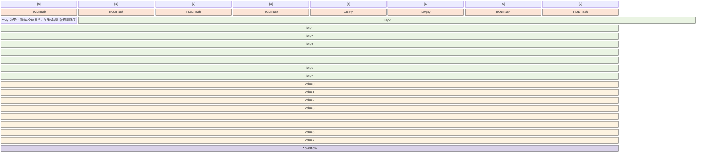
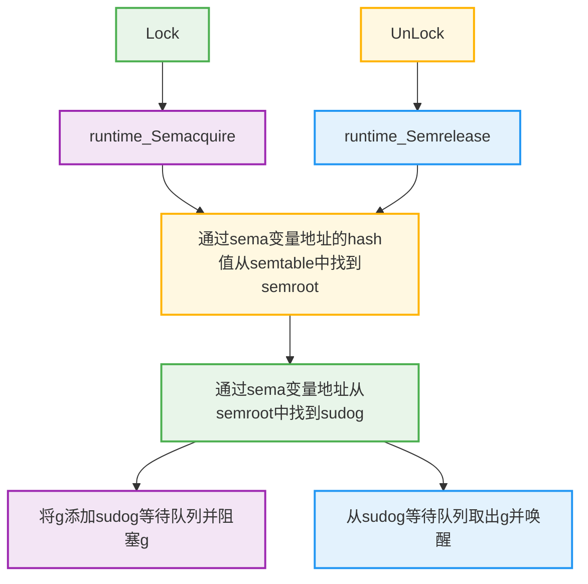

# Go面试题

几个特别值得花时间搞透的模块：
+ **Slice 和 Map**：不只是会用，要知道扩容机制、底层结构、并发安全问题，这两个基本是每场面试必提。
+ **Channel 和并发**：Go 最有特色的地方，Channel 的收发过程、select 的执行机制、各种锁的底层实现，面试官特别喜欢在这里深挖。
+ **GMP 调度模型**：Go 高并发的核心，P 的作用、work-stealing、goroutine 调度时机，这块是 Go 进阶面试的分水岭。
+ GC 垃圾回收：三色标记法、写屏障、STW，理解原理比死记结论重要得多。

## 基础面试题
### 与其他语言相比，使用 Go 有什么好处?

+ Go的语法更简洁。每个功能和语法决策都旨在让程序员的开发效率更高 
+ Golang 针对并发进行了优化，支持协程，并且实现了高效的GMP调度模型
+ 单一的标准代码格式，语法简单，易学，团队协作方便
+ 有高效的垃圾回收机制，支持并行垃圾回收，垃圾回收效率比比 Java 或 Python 更高

### 什么是协程？

协程是用户态轻量级线程，它是线程调度的基本单位。通常在函数前加上 go 关键字就能实现并发。一个 Goroutine 会以一个很小的栈启动（自 Go 1.4 起初始 2KB，早期版本曾为 8KB），当遇到栈空间不足时，栈会自动伸缩，因此可以轻易实现成千上万个 goroutine 同时启动。

#AI，此处的初始2KB查询一下是否为最新版的设定，若不是，指出。

### 协程和线程和进程的区别？

+ 进程：
    + 进程是具有一定独立功能的程序，进程是系统资源分配和调度的最小单位
    + 每个进程都有自己的独立内存空间，不同进程通过进程间通信来通信
    + 由于进程比较重量，占据独立的内存，所以上下文进程间的切换开销（栈、寄存器、虚拟内存、文件句柄等）比较大，但相对比较稳定安全
+ 线程：
    + 线程是进程的一个实体,线程是内核态，而且是 CPU 调度和分派的基本单位,它是比进程更小的能独立运行的基本单位
    + 线程间通信主要通过共享内存，上下文切换很快，资源开销较少，但相比进程不够稳定容易丢失数据
+ 协程：
    + 协程是一种用户态的轻量级线程，协程的调度完全是由用户来控制的。
    + 协程拥有自己的寄存器上下文和栈。 
    + 协程调度切换时，将寄存器上下文和栈保存到其他地方，在切回来的时候，恢复先前保存的寄存器上下文和栈，直接操作栈则基本没有内核切换的开销，可以不加锁的访问全局变量，所以上下文的切换非常快。

#AI，协程此处的其它地方是什么。写入。然后这三种的区别文本可适当优化，并打个表用于快速一览区别。补充无stack协程。

### Golang 中 make 和 new 的区别？

`make` 和 `new` 都是用于内存分配的内建函数，但它们的使用场景和功能有所不同：

+ `make`：
    + 用于初始化并分配内存，只能用于创建 slice、map 和 channel 三种类型。
    + 返回的是初始化后的数据结构，而不是指针。 
+ `new`： 
    + 用于分配内存，但不初始化，返回的是指向该内存的指针。
    + 可以用于任何类型的内存分配。

```go
// 使用 make 创建 slice
s := make([]int, 5) // 创建一个长度为 5 的 slice
fmt.Println(s)      // 输出: [0 0 0 0 0]// 使用 new 创建 int 指针
p := new(int)       // 分配内存给 int 类型
fmt.Println(*p)     // 输出: 0 (初始值)
```

### Golang 中数组和切片的区别？

数组：
+ 数组固定长度。
    + 数组长度是数组类型的一部分，所以[3]int 和[4]int 是两种不同的数组类型
+ 数组需要指定大小，不指定也会根据初始化，自动推算出大小，大小不可改变
+ 数组是通过值传递的

切片: 
+ 切片可以改变长度。
+ 切片是轻量级的数据结构，三个属性：指针、长度、容量
+ 不需要指定大小
+ 切片在传参时按值传递的是 slice header（包含底层数组指针、长度、容量）的副本
    + 因为副本中的指针指向同一底层数组，所以函数内对底层数组元素的修改对调用方可见。
+ 切片可以通过数组来初始化，也可以通过内置函数 make() 来初始化，初始化的时候 len=cap，然后进行扩容
    + cap也可以手动指定

slice 的底层数据其实也是数组，slice 是对数组的封装，它描述一个数组的片段。
slice 实际上是一个结构体，包含三个字段：长度、容量、底层数组。
```go
// runtime/slice.go
type slice struct {
    array unsafe.Pointer // 元素指针
    len   int // 长度 
    cap   int // 容量
}
```

### 使用`for range`的时候，它的地址会发生变化吗？

行为与版本有关。
在1.22版前，for循环提供的是一个地址不变的指针。
1.22版起，改成了一个每次循环都会是新地址的指针。

#AI，这里添加一个新旧版本能有区别的代码示例。

### 如何高效地拼接字符串？

+ `+` 会对字符串进行遍历，计算并开辟一个新的空间来存储原来的两个字符串
+ `fmt.Sprintf` 必须要用反射获取值，因此有性能损耗
+ `strings.Builder` 用WriteString()进行拼接，内部实现是指针+切片，然后将[]byte零拷贝转化为String
+ `bytes.Buffer` 底层也是一个[]byte切片
+ `strings.join` 也是基于strings.builder来实现的,并且可以自定义分隔符。内部会提取计算容量，内存分配高效。

\\(strings.Join \approx strings.Builder\gt bytes.Buffer \gt + \gt fmt.Sprintf\\)

#AI,此处提供一个示例代码

### defer 的执行顺序是怎样的？defer 的作用或者使用场景是什么?

defer执行顺序和调用顺序相反，类似于栈后进先出(LIFO)

#AI，详细的指出return/defer/panic的执行顺序。编写文本和对应的示例代码。同时要指出易错点。

### 什么是rune类型

+ uint8 类型，或者叫 byte 型，代表了 ASCII 码的一个字符
+ rune 类型，代表一个 Unicode 码点（code point），当需要处理中文、日文或者其他非 ASCII 字符时，则需要用到 rune 类型

> rune 是 int32 的别名（UTF-8 是 Go 字符串的底层编码方式，rune 表示的是 Unicode 标量值，两者概念不同）。

### Go 语言 tag 有什么用

#AI，完善下面这段话。使其详细，适合学习

一种软约定，配合go语言的反射功能实现强大的功能。
如：序列化与反序列化、数据库 ORM 映射

### go打印时`%v`\\`%+v`\\`%#v` 的区别

+ `%v` 只输出所有的值
+ `%+v` 先输出字段名字，再输出该字段的值
+ `%#v` 先输出结构体名字值，再输出结构体（字段名字+字段的值）

#AI，编写一个示例Go代码展示

### Go语言中空`struct{}`占用空间么?

可以使用`unsafe.Sizeof`计算出一个数据类型实例需要占用的字节数，空`struct{}`不占用任何空间

### Go语言中，空 `struct{}` 有什么用

+ 模拟Set。`type Set map[string]struct{}`
+ 给通道发信息。`channel<-struct{}{}`
+ 表示仅有方法的结构体。`type Lamp struct{}`

### init() 函数是什么时候执行的?

main()之前

+ init()函数是go初始化的一部分，由runtime初始化每个导入的包，初始化不是按照从上到下的导入顺序，而是按照解析的依赖关系，没有依赖的包最先初始化。
+ 每个包首先初始化包作用域的常量和变量（常量优先于变量）
+ 然后执行包的init()函数。
    + 同一个包，甚至是同一个源文件可以有多个init()函数。
    + init()函数没有入参和返回值，不能被其他函数调用
    + 同一个包内多个init()函数的执行顺序不作保证。
执行顺序：\\(import \rightarrow const \rightarrow var \rightarrow init()\rightarrow main()\\)

#AI，检查描述是否符合最新版本。并绘制一张图描述时序

### 2 个 interface 可以比较吗
+ 若两个都是nil，相等
+ 若只有一个nil，不等
+ 若都非nil
    + 先比较类型
    + 类型相同就看能不能比值

```go
type Stu struct {
     Name string
}

type StuInt interface{}

func main() {
     var stu1, stu2 StuInt = &Stu{"Tom"}, &Stu{"Tom"}
     var stu3, stu4 StuInt = Stu{"Tom"}, Stu{"Tom"}
     fmt.Println(stu1 == stu2) // false
     fmt.Println(stu3 == stu4) // true
}
```

#AI,检查描述，并绘制一个判定流程图。尽可能的新版本go

### 2 个 nil 可能不相等吗

可能不等。interface 内部由 (动态类型 T, 动态值 V) 两部分组成，只有当 T 和 V 都为 nil 时，接口才等于 nil。

把一个类型化的 nil 指针（typed nil，如 (*int)(nil)）装入接口后，接口的动态类型不是 nil，所以接口不等于 nil——这是 Go 中最常见的"nil 陷阱"。举个例子：

```go
func foo() error {
    var err *MyError = nil
    return err
}

if foo() != nil {  // 进入此分支
    // ...
}
```

### Go 语言函数传参是值类型还是引用类型？

+ 在 Go 语言中只存在值传递，要么是值的副本，要么是指针的副本。
    + 无论是值类型的变量还是引用类型的变量亦或是指针类型的变量作为参数传递都会发生值拷贝，开辟新的内存空间
+ 另外值传递、引用传递和值类型、引用类型是两个不同的概念，不要混淆了。引用类型作为变量传递可以影响到函数外部是因为发生值拷贝后新旧变量指向了相同的内存地址。

### 如何知道一个对象是分配在栈上还是堆上？

Go和C++不同，Go局部变量会进行逃逸分析。
    + 如果变量离开作用域后没有被引用，则优先分配到栈上，否则分配到堆上。
    + 那么如何判断是否发生了逃逸呢？`go build -gcflags '-m -m -l' xxx.go`

关于逃逸的可能情况：
+ 变量大小不确定
+ 变量类型不确定
+ 变量分配的内存超过用户栈最大值
+ 暴露给了外部指针。

### Go语言的多返回值是如何实现的

Go 语言的多返回值是通过在函数调用栈帧上预留空间并进行值复制来实现的。

在函数调用发生时，Go 编译器会计算出函数所有返回值的总大小。在为该函数创建栈帧时，就会在调用方（caller）的栈帧上，为这些返回值预留出连续的内存空间。

当函数执行到 return 语句时，它会将其要返回的各个值复制到这些预留好的栈空间中。函数执行完毕后，控制权返回给调用方。此时，调用方可以直接从它自己的栈帧上（即之前为返回值预留的空间）获取这些返回的值。

### Go语言中"_"的作用
+ 忽略多返回值
+ 有时你可能只想执行包的 `init()` 函数（例如，注册驱动、初始化全局变量等），而不需要直接使用包中的任何导出成员。这时，你就可以使用 `_` 来进行匿名导入

### Go语言普通指针和unsafe.Pointer有什么区别？

普通指针比如`*int`、`*string`，它们有明确的类型信息，编译器会进行类型检查和垃圾回收跟踪。
不同类型的指针之间不能直接转换，这是Go类型安全的体现。

而unsafe.Pointer是Go的通用指针类型，可以理解为C语言中的`void*`，它绕过了Go的类型系统。`unsafe.Pointer`可以与任意类型的指针相互转换，也可以与uintptr进行转换来做指针运算。

另外，普通指针受 GC 管理和类型约束，unsafe.Pointer 不受类型约束但仍受 GC 跟踪。

### unsafe.Pointer与uintptr有什么区别和联系

unsafe.Pointer和uintptr可以相互转换，这是Go提供的唯一合法的指针运算方式。典型用法是先将unsafe.Pointer转为uintptr做算术运算，然后再转回unsafe.Pointer使用。

最关键的区别在于GC跟踪。unsafe.Pointer会被垃圾回收器跟踪，它指向的内存不会被错误回收；而uintptr只是一个普通整数，GC完全不知道它指向什么，如果没有其他引用，对应内存可能随时被回收。

所以记住：unsafe.Pointer有GC保护，uintptr没有，这是它们最本质的区别。

#AI,上面这3段话重写并添加`unsafe.Add`的信息

#AI，绘制一个表格对比这3种指针

## slice面试题
### slice的底层结构

slice 的底层数据其实也是数组，slice 是对数组的封装，它描述一个数组的片段。
> slice 实际上是一个结构体，包含三个字段：长度、容量、底层数组。

#AI，绘制一个slice的结构示意图

### Go语言里slice是怎么扩容的？

1.17及以前：
+ 如果期望容量大于当前容量的两倍就会使用期望容量
+ 如果当前切片的容量小于 1024 就会将容量翻倍
+ 如果当前切片的容量大于等于 1024 就会每次增加 25% 的容量，直到新容量大于期望容量

1.18及以后：
+ 当原slice容量(oldcap)小于256的时候，新slice(newcap)容量为原来的2倍
+ 原slice容量超过256，新slice容量newcap = oldcap+(oldcap+3*256)/4

### 从一个切片截取出另一个切片，修改新切片的值会影响原来的切片内容吗

在截取完之后，如果新切片没有触发扩容，则修改切片元素会影响原切片，如果触发了扩容则不会。

```go
package main

import "fmt"

func main() {
	slice := []int{0, 1, 2, 3, 4, 5, 6, 7, 8, 9}
	s1 := slice[2:5]
	s2 := s1[2:6:7]

	s2 = append(s2, 100)
	s2 = append(s2, 200)

	s1[2] = 20

	fmt.Println(s1)
	fmt.Println(s2)
	fmt.Println(slice)
}
```
预期结果：
```bash
[2 3 20]
[4 5 6 7 100 200]
[0 1 2 3 20 5 6 7 100 9]
```

代码详解：

s1 从 slice 索引2（闭区间）到索引5（开区间，元素真正取到索引4），长度为3，容量默认到数组结尾，为8。 
s2 从 s1 的索引2（闭区间）到索引6（开区间，元素真正取到索引5），容量到索引7（开区间，真正到索引6），为5。

#AI，这里绘制slice\s1\s2的示意图，一行一个，左侧是名称，中间是一排方格方有数据，没有数据的不填数据，但是方格要画出来（最好虚化方格） 最右侧标记len=多少，cap=多少

```go
s2 = append(s2,100)
```

s2的容量够，此时，s1和slice也都会被修改。

#AI，这里绘制一个图，与上一个图结构相似，但是重点标记处新增的100（s1和slice上都有100的标记）

```go
s2 = append(s2,200)
```

此时s2的容量不够了，发生了复制扩容，s2的底层数组发生改变。

#AI，绘制一个图，与上一个图结构相似，但是s2和另外两个之间画一个虚线表示分家了，同时重点标记新增的200，100不在重点标记（但是标记出来）

```go
s1[2]=20
```

#AI,在上一个图的基础上重点标记变成20的修改（同理200不在是重点标记）

再提一点，打印 s1 的时候，只会打印出 s1 长度以内的元素。所以，只会打印出3个元素，虽然它的底层数组不止3个元素。

### slice作为函数参数传递，会改变原slice吗？

当 slice 作为函数参数时，因为会拷贝一份新的slice作为实参，所以原来的 slice 结构并不会被函数中的操作改变，也就是说，slice 其实是一个结构体，包含了三个成员：len, cap, array并不会变化。但是需要注意的是，尽管slice结构不会变，但是其底层数组的数据如果有修改的话，则会发生变化。若传的是 slice 的指针，则原 slice 结构会变，底层数组的数据也会变。

这里传递的是一个 slice 的副本，在 f 函数中，s 只是 main 函数中 s 的一个拷贝。在f 函数内部，对 s 的作用并不会改变外层 main 函数的 s的结构。
```go
package main

func main() {
	s := []int{1, 1, 1}
	f(s)
	fmt.Println(s)
}

func f(s []int) {
	for i := range s {
		s[i] += 1
	}
}
```
预期输出
```bash
[2 2 2]
```

要想真的改变外层 slice，只有将返回的新的 slice 赋值到原始 slice，或者向函数传递一个指向 slice 的指针。
```go
package main

import "fmt"

func myAppend(s []int) []int {
	// 这里 s 虽然改变了，但并不会影响外层函数的 s
	s = append(s, 100)
	return s
}

func myAppendPtr(s *[]int) {
	// 会改变外层 s 本身
	*s = append(*s, 100)
	return
}

func main() {
	s := []int{1, 1, 1}
	newS := myAppend(s)

	fmt.Println(s)
	fmt.Println(newS)

	s = newS

	myAppendPtr(&s)
	fmt.Println(s)
}
```
预期输出：
```bash
[1 1 1]
[1 1 1 100]
[1 1 1 100 100]
```

## Map面试题

### Go语言Map的底层实现原理是怎样的

map的就是一个hmap的结构。
+ Go Map的底层实现是一个哈希表。
+ 它在运行时表现为一个指向hmap结构体的指针，hmap中记录了桶数组指针buckets、溢出桶指针以及元素个数等字段。
+ 每个桶是一个bmap结构体，能存储8个键值对和8个tophash，并有指向下一个溢出桶的指针overflow。
+ 为了内存紧凑，bmap中采用的是先存8个键再存8个值的存储方式。

```go
// A header for a Go map.
type hmap struct {
   count     int // map中元素个数
   flags     uint8 // 状态标志位，标记map的一些状态
   B         uint8  // 桶数以2为底的对数，即B=log_2(len(buckets))，比如B=3，那么桶数为2^3=8
   noverflow uint16 //溢出桶数量近似值
   hash0     uint32 // 哈希种子

   buckets    unsafe.Pointer // 指向buckets数组的指针
   oldbuckets unsafe.Pointer // 是一个指向buckets数组的指针，在扩容时，oldbuckets 指向老的buckets数组(大小为新buckets数组的一半)，非扩容时，oldbuckets 为空
   nevacuate  uintptr        // 表示扩容进度的一个计数器，小于该值的桶已经完成迁移

   extra *mapextra // 指向mapextra 结构的指针，mapextra 存储map中的溢出桶
}
```
bmap结构如下：

```mermaid
flowchart LR
    classDef hmap fill:#fdf3e1,stroke:#333,stroke-width:1px
    classDef arr fill:#eaf3fb,stroke:#333,stroke-width:1px
    classDef bmap fill:#eaf4e3,stroke:#333,stroke-width:1px
    classDef extra fill:#ede8f4,stroke:#333,stroke-width:1px
    classDef nil fill:#d95c5c,stroke:#d95c5c,color:#fff

    subgraph HMAP["hmap"]
        direction TB
        h_count["count"]
        h_flags["flags"]
        h_B["B = 5"]
        h_noverflow["noverflow"]
        h_buckets["* buckets"]
        h_oldbuckets["* oldbuckets"]
        h_nevacuate["nevacuate"]
        h_extra["* extra"]
        h_count ~~~ h_flags ~~~ h_B ~~~ h_noverflow ~~~ h_buckets ~~~ h_oldbuckets ~~~ h_nevacuate ~~~ h_extra
        class h_count,h_flags,h_B,h_noverflow,h_buckets,h_oldbuckets,h_nevacuate,h_extra hmap
    end
    
    subgraph BUCKETS["[]bmap"]
        direction TB
        b0["0"]
        b1["1"]
        b2["2"]
        b3["3"]
        b4["4"]
        dots["......"]
        b30["30"]
        b31["31"]
        b0 ~~~ b1 ~~~ b2 ~~~ b3 ~~~ b4 ~~~ dots ~~~ b30 ~~~ b31
        class b0,b1,b2,b3,b4,dots,b30,b31 arr
    end
    
    subgraph BMAP0["bmap"]
        direction TB
        bm0_t["tophash"]
        bm0_k["keys"]
        bm0_v["values"]
        bm0_p["pad"]
        bm0_o["* overflow"]
        bm0_t ~~~ bm0_k ~~~ bm0_v ~~~ bm0_p ~~~ bm0_o
        class bm0_t,bm0_k,bm0_v,bm0_p,bm0_o bmap
    end

    subgraph BMAP1["bmap"]
        direction TB
        bm1_t["tophash"]
        bm1_k["keys"]
        bm1_v["values"]
        bm1_p["pad"]
        bm1_o["* overflow"]
        bm1_t ~~~ bm1_k ~~~ bm1_v ~~~ bm1_p ~~~ bm1_o
        class bm1_t,bm1_k,bm1_v,bm1_p,bm1_o bmap
    end

    subgraph BMAP2["bmap"]
        direction TB
        bm2_t["tophash"]
        bm2_k["keys"]
        bm2_v["values"]
        bm2_p["pad"]
        bm2_o["* overflow"]
        bm2_t ~~~ bm2_k ~~~ bm2_v ~~~ bm2_p ~~~ bm2_o
        class bm2_t,bm2_k,bm2_v,bm2_p,bm2_o bmap
    end

    subgraph BMAP3["bmap"]
        direction TB
        bm3_t["tophash"]
        bm3_k["keys"]
        bm3_v["values"]
        bm3_p["pad"]
        bm3_o["* overflow"]
        bm3_t ~~~ bm3_k ~~~ bm3_v ~~~ bm3_p ~~~ bm3_o
        class bm3_t,bm3_k,bm3_v,bm3_p,bm3_o bmap
    end

    subgraph EXTRA["mapextra"]
        direction TB
        me_o["overflow"]
        me_n["nextoverflow"]
        me_o ~~~ me_n
        class me_o,me_n extra
    end
    
    NIL(("nil")):::nil
    
    h_buckets --> BUCKETS
    h_extra --> EXTRA
    
    b0 --> BMAP0
    b1 --> BMAP2
    b4 --> BMAP3
    
    bm0_o --> BMAP1
    bm1_o --> NIL
    
    bm2_o --> NIL
    bm3_o --> NIL
```




### Go语言Map的遍历是有序的还是无序的

Go语言里Map的遍历是完全随机的，并没有固定的顺序。map每次遍历,都会从一个随机值序号的桶,在每个桶中，再从按照之前选定随机槽位开始遍历,所以是无序的。

### Go语言Map的遍历为什么要设计成无序的

Go团队为了避免开发者写出依赖底层实现细节的脆弱代码，而有意为之的一个设计。

通过在遍历时引入随机数，Go从根本上杜绝了程序员依赖特定遍历顺序的可能性，强制我们写出更健壮的代码。

### Map如何实现顺序读取

如果业务上确实需要有序遍历，最规范的做法就是将Map的键（Key）取出来放入一个切片（Slice）中，用sort包对切片进行排序，然后根据这个有序的切片去遍历Map。

### Go语言的Map是否是并发安全的

在 Go 的 map 实现中，查找、赋值、遍历和删除等操作都会检测 `hashWriting` 写标志。其中，查找和遍历只检测该标志而不置位；赋值和删除在确认写标志未置位后，会先将该标志置位，再执行后续操作，并在写操作结束前检查并清除该标志。若任一操作检测到写标志已被置位，说明当前已有 goroutine 正在对该 map 执行写操作（赋值或删除），此时会直接调用 `throw`，触发 runtime fatal error；该错误不可被 `recover` 捕获。

### Map的Key一定要是可比较的吗？为什么？

不同的Key可能会产生相同的哈希值，这就是"哈希冲突"。
当多个Key被定位到同一个"桶"里时，Map就没法只靠哈希值来区分它们了。
此时，它必须在桶内进行逐个遍历，用我们传入的Key和桶里已有的每一个Key进行**相等**比较。
这样才能确保我们操作的是正确的键值对。

### Go语言Map的扩容时机是怎样的？

向 map 插入新 key 的时候，会进行条件检测，符合下面这 2 个条件，就会触发扩容：
+ 装载因子超过阈值（源码里定义的阈值是 6.5），触发双倍扩容（B+1，buckets 数量翻倍）。
+ overflow 的 bucket 数量过多（触发等量扩容，B 不变，仅重新整理键值对让分布更紧凑）：
    + 当 \\(B\lt 15\\)，也就是 bucket 总数 \\(2^B\lt 2^{15}\\) 时，如果 overflow 的 bucket 数量超过 \\(2^B\\)
    + 当 \\(B \geq 15\\)，也就是 bucket 总数 \\(2^B\\) 大于等于 \\(2^{15}\\)，如果 overflow 的 bucket 数量超过 \\(2^{15}\\)。

### Go语言Map的扩容过程是怎样的？
Go的扩容是渐进式（gradual）的。

它不会在触发扩容时"stop the world"来一次性把所有数据搬迁到新空间，而是只分配新空间，然后在后续的每一次插入、修改或删除操作时，才会顺便搬迁一两个旧桶的数据。这种设计将庞大的扩容成本分摊到了多次操作中，极大地减少了服务的瞬间延迟（STW），保证了性能的平滑性。

+ 如果是触发双倍扩容，会新建一个buckets数组，新的buckets数量大小是原来的2倍，然后旧buckets数据搬迁到新的buckets。
+ 如果是等量扩容，buckets数量维持不变，重新做一遍类似双倍扩容的搬迁动作，把松散的键值对重新排列一次，使得同一个 bucket 中的 key 排列地更紧密，这样节省空间，存取效率更高

### 可以对Map的元素取地址吗

不行

### Map 中删除一个 key，它的内存会释放么
不会，delete一个key，并不会立刻释放或收缩Map占用的内存。

具体来说，delete(m, key) 这个操作，只是把key和value对应的内存块标记为"空闲"，让它们的内容可以被后续的垃圾回收（GC）处理掉。

但是，Map底层为了存储这些键值对而分配的"桶"（buckets）数组，它的规模是不会缩小的。
只有当 map 失去所有引用（被置为 nil 或离开作用域）后，整个 map 的空间才会被垃圾回收后释放。

### Map可以边遍历边删除吗

在单个goroutine里可以，但结果是不确定的。

## Channel面试题

### 什么是CSP

通过通信共享内存，而不是通过内存来通信的并发编程模型。

+ 避免共享内存：协程（Goroutine）不直接修改变量，而是通过 Channel 通信
+ 天然同步：Channel 的发送/接收自带同步机制，无需手动加锁
+ 易于组合：Channel 可以嵌套使用，构建复杂并发模式（如管道、超时控制）

### Channel的底层实现原理是怎样的

底层是`hchan`的结构体，核心包含几个关键组件：
+ 环形缓冲区
    + 有缓冲channel内部维护一个固定大小的环形队列，用buf指针指向缓冲区，sendx和recvx分别记录发送和接收的位置索引。
    + 这样设计能高效利用内存，避免数据搬移。
+ 两个等待队列sendq和recvq
    + 用来管理阻塞的goroutine。
    + sendq存储因channel满而阻塞的发送者
    + recvq存储因channel空而阻塞的接收者
    + 这些队列用双向链表实现，当条件满足时会唤醒对应的goroutine。
+ 互斥锁
    + 所有的发送、接收操作都需要先获取锁，用来保证并发安全

```go
type hchan struct {
        // chan 里元素数量
        qcount   uint
        // chan 底层循环数组的长度
        dataqsiz uint
        // 指向底层循环数组的指针
        // 只针对有缓冲的 channel
        buf      unsafe.Pointer
        // chan 中元素大小
        elemsize uint16
        // chan 是否被关闭的标志
        closed   uint32
        // chan 中元素类型
        elemtype *_type // element type
        // 已发送元素在循环数组中的索引
        sendx    uint   // send index
        // 已接收元素在循环数组中的索引
        recvx    uint   // receive index
        // 等待接收的 goroutine 队列
        recvq    waitq  // list of recv waiters
        // 等待发送的 goroutine 队列
        sendq    waitq  // list of send waiters

        // 保护 hchan 中所有字段
        lock mutex
}
```

### 向channel发送数据的过程是怎样的
整个过程都会在mutex保护下进行，保证并发安全。

关键步骤：
1. 首先是检查是否有等待的接收者
2. 如果没有等待接收者，就尝试写入缓冲区
3. 当缓冲区满了就需要阻塞等待


被唤醒后继续执行。当有接收者从channel读取数据后，会从sendq中唤醒一个等待的发送者，被唤醒的goroutine会完成数据发送并继续执行。

向已关闭的channel发送数据会直接panic。

### 从Channel读取数据的过程是怎样的

关键步骤：
1. 首先检查是否有等待的发送者
2. 如果没有等待发送者，尝试从缓冲区读取

缓冲区为空时需要阻塞等待

从已关闭channel读取有特殊处理。
+ 如果channel已关闭且缓冲区为空，会返回零值和false标志
+ 如果缓冲区还有数据，可以正常读取直到清空。这就是为什么`v, ok := <-ch`中的ok能判断channel状态的原因。

### 从一个已关闭Channel仍能读出数据吗

从一个有缓冲的 channel 里读数据，当 channel 被关闭，依然能读出有效值。
只有当返回的 ok 为 false 时，读出的数据才是无效的。

### Channel在什么情况下会引起内存泄漏

Channel引起内存泄漏最常见的是引起goroutine泄漏从而导致的间接内存泄漏

> 当goroutine阻塞在channel操作上永远无法退出时，goroutine本身和它引用的所有变量都无法被GC回收。比如一个goroutine在等待接收数据，但发送者已经退出了，这个接收者就会永远阻塞下去。

或者select语句使用不当，在没有default分支的select中，如果所有case都无法执行，goroutine会永远阻塞。出现内存泄漏

### 关闭Channel会产生异常吗

试图重复关闭一个channel、关闭一个nil值的channel、关闭一个只有接收方向的channel都将导致panic异常。

> 发送方负责关闭

### 往一个关闭的Channel写入数据会发生什么

往已关闭的channel写入数据会直接panic。\\

向已关闭的channel发送数据时，runtime会检测到channel的closed标志位已经设置，立即抛出"send on closed channel"的panic。
这个检查发生在发送操作的最开始阶段，甚至在获取mutex锁之前就会进行判断，所以不会有任何数据写入的尝试，直接就panic了。

### 什么是select

select是Go语言专门为channel操作设计的多路复用控制结构，类似于网络编程中的select系统调用。

核心作用是同时监听多个channel操作。
当有多个channel都可能有数据收发时，select能够选择其中一个可执行的case进行操作，而不是按顺序逐个尝试。
比如同时监听数据输入、超时信号、取消信号等。

### select的执行机制是怎样的

随机选择。
+ 如果多个case同时满足条件，Go会随机选择一个执行，这避免了饥饿问题。
+ 如果没有case能执行就会执行default，如果没有default，当前goroutine会阻塞等待。

###  select的实现原理是怎样的

case随机化 + 双重循环检测

Go语言实现select时，定义了一个数据结构scase表示每个case语句(包含default)。scase结构包含channel指针、操作类型等信息。select操作的整个过程通过selectgo函数**在runtime层面实现**。

Go运行时会将所有case进行随机排序，这是为了避免饥饿问题。
然后执行两轮扫描策略：
+ 第一轮直接检查每个channel是否可读写，如果找到就绪的立即执行
+ 如果都没就绪，第二轮就把当前goroutine加入到所有channel的发送或接收队列中，然后调用gopark进入睡眠状态，使当前goroutine让出CPU。

当某个channel变为可操作时，调度器会唤醒对应的goroutine，此时需要从其他channel的等待队列中清理掉这个goroutine，然后执行对应的case分支。

select 语句会在编译阶段经过如下过程的处理：
+ 将所有的 case 转换成包含Channel以及类型等信息的 scase 结构体
+ 调用运行时函数 selectgo获取被选择的scase 结构体索引
    + 如果当前的scase是一个接收数据的操作，还会返回一个指示当前case 是否是接收的布尔值；
+ 通过for循环生成一组if语句，在语句中判断自己是不是被选中的 case。

```go
type scase struct {
    c    *hchan   // channel指针
    elem unsafe.Pointer  // 数据元素指针，用于存放发送/接收的数据
    kind uint16   // case类型：caseNil、caseRecv、caseSend、caseDefault
    pc   uintptr  // 程序计数器，用于调试
    releasetime int64  // 释放时间，用于竞态检测
}
```

## Sync面试题

### 除了 mutex 以外还有那些方式安全读写共享变量

除了Mutex，主要还有信号量、通道（Channel），原子操作（atomic）这几种方式。

chanenl是Go最推崇的方式，它通过通信来传递数据所有权，从根源上避免竞争，更适合复杂的业务逻辑；
而原子操作则针对最简单的整型或指针等进行无锁操作，性能最高，常用于实现计数器或状态位。

选择哪种，完全取决于数据结构的复杂度和业务的读写模型。

### Go 语言是如何实现原子操作的

依赖底层CPU硬件提供的原子指令

### 聊聊原子操作和锁的区别

区别在于它们的实现层级和保护范围

原子操作是CPU硬件层面的"微观"机制，它保证对单个数据（通常是整型或指针）的单次读改写操作是绝对不可分割的，性能极高，因为它不涉及操作系统内核的介入和goroutine的挂起。

锁则是操作系统或语言运行时提供的"宏观"机制，它保护的是一个代码块（临界区），而不仅仅是单个变量。
当获取锁失败时，它会让goroutine休眠，而不是空耗CPU。
虽然锁的开销远大于原子操作，但它能保护一段复杂的、涉及多个变量的业务逻辑。

+ 对于简单的计数器或标志位更新，用原子操作追求极致性能
+ 而只要需要保护一段逻辑或多个变量的一致性，就必须用锁。

### Go语言互斥锁mutex底层是怎么实现的

mutex底层是通过原子操作加信号量来实现的，通过atomic 包中的一些原子操作来实现锁的锁定，通过信号量来实现协程的阻塞与唤醒。

> go的锁并没有实际包含任何自定义变量，与其它代码无关

```go
type Mutex struct {  
  state int32  
  sema  uint32
}
```
state表示锁的状态，有锁定、被唤醒、饥饿模式等，并且是用state的二进制位来标识的，不同模式下会有不同的处理方式。

#AI，绘制一个图，横向的，用于表示state的结构。state的前29bit是表示阻塞等待锁的协程个数，协程解锁时，根据此值判断是否需要释放信号量，紧接着1bit表示是否处于饥饿状态，在跟着1bit表示协程是否唤醒，最后1bit表示mutex是否已被锁定

sema表示信号量，mutex阻塞队列的定位是通过这个变量来实现的，从而实现goroutine的阻塞和唤醒



### Mutex有几种模式

Go的Mutex主要有两种模式：正常模式（Normal Mode）和饥饿模式（Starvation Mode）。

+ 正常模式：这是默认模式，讲究的是性能。
    + 新请求锁的goroutine会和等待队列头部的goroutine竞争，新来的goroutine有几次"自旋"的机会，如果在此期间锁被释放，它就可以直接抢到锁。
    + 这种方式吞吐量高，但可能会导致队列头部的goroutine等待很久，即"不公平"。
+ 饥饿模式：当一个 goroutine 在等待队列中等待超过 1 毫秒（1ms）后，Mutex 就会切换到此模式，讲究的是公平。
    + 在此模式下，锁的所有权会直接从解锁的goroutine移交给等待队列的头部，新来的goroutine不会自旋，必须排到队尾。
    + 这样可以确保队列中的等待者不会被"饿死"。

### 在Mutex上自旋的goroutine 会占用太多资源吗

不会

+ 自旋不是无休止的空转，它有严格的次数和时间限制，通常只持续几十纳秒。
+ 自旋仅仅在特定条件下才会发生，比如CPU核数大于1，并且当前机器不算繁忙（没有太多goroutine在排队）。
> 它是在赌，与其付出"goroutine挂起和唤醒"这种涉及内核调度的巨大代价，不如原地"稍等一下"，因为锁可能马上就释放了。

自旋是一种机会主义的短线优化，目的是用极小的CPU开销去避免一次昂贵的上下文切换，在锁竞争不激烈、占用时间极短的场景下，它反而是**节省了资源**。

### mutex已经被一个goroutine获取了其它等待中的goroutine们只能一直等待。那么等这个锁释放后等待中的goroutine中哪一个会优先获取mutex呢

正常模式：
+ 锁的分配是"不公平"的。当锁被释放时，等待队列中的第一个goroutine会被唤醒，但它不一定能拿到锁。
+ 它需要和那些此刻刚刚到达、正在自旋的新goroutine进行竞争。
+ 新来的goroutine因为正在CPU上运行，很有可能"插队"成功，直接抢到锁。
+ 这种策略的优点是吞吐量高，但缺点是可能导致等待队列中的goroutine被饿死。

饥饿模式：
+ 锁的分配就变得"绝对公平"。
+ 锁被释放后，会直接移交给等待队列的队头goroutine，任何新来的goroutine都不会参与竞争，必须乖乖排到队尾。

### sync.Once 的作用是什么，讲讲它的底层实现原理？

sync.Once的作用是确保一个函数在程序生命周期内，无论在多少个goroutine中被调用，都只会被执行一次。

它常用于单例对象的初始化或一些只需要执行一次的全局配置加载

```go
type Once struct {
    done uint32  // 标识位
    m    Mutex
}
```

当Once.Do(f)首次被调用时：
1. 它首先会通过原子操作（atomic.LoadUint32）快速检查done标志位。如果done为1，说明初始化已完成，直接返回，这个路径完全无锁，开销极小。
2. 如果done为0，说明可能是第一次调用，这时它会进入一个慢路径（doSlow）。
3. 在慢路径里，它会先加锁，然后再次检查done标志位。这个"双重检查"（Double-Checked Locking）是关键，它防止了在多个goroutine同时进入慢路径时，函数f被重复执行。
4. 如果此时done仍然为0，那么当前goroutine就会执行传入的函数f。执行完毕后，它会通过原子操作（atomic.StoreUint32）将done标志位置为1，最后解锁。

### WaitGroup 是怎样实现协程等待？

WaitGroup实现等待，本质上是一个原子计数器和一个信号量的协作。

调用Add会增加计数值，Done会减计数值。
而Wait方法会检查这个计数器，如果不为零，就利用信号量将当前goroutine高效地挂起。
直到最后一个Done调用将计数器清零，它就会通过这个信号量，一次性唤醒所有在Wait处等待的goroutine，从而实现等待目的。

```go
// A WaitGroup waits for a collection of goroutines to finish.
// The main goroutine calls Add to set the number of goroutines to wait for.
// Then each of the goroutines runs and calls Done when finished. At the same
// time, Wait can be used to block until all goroutines have finished.
//
// A WaitGroup must not be copied after first use.#AI,新增一段翻译后的注释，不删除原文
type WaitGroup struct {
        noCopy noCopy // 用于vet工具检查是否被复制

        // 64位的值：高32位是计数器，低32位是等待的goroutine数量。
        // 通过原子操作访问，保存了状态和等待者数量。
        state atomic.Uint64

        // 用于等待者休眠的信号量。
        sema uint32
}
```

noCopy: 这是一个特殊的字段，用于静态分析工具（go vet）在编译时检查WaitGroup实例是否被复制。WaitGroup被复制后会导致状态不一致，可能引发程序错误，因此该字段的存在旨在防止此类问题的发生。

state: 这是WaitGroup的核心，一个64位的无符号整型，通过sync/atomic包进行原子操作，以保证并发安全。这个64位的空间被巧妙地分成了两部分：
+ 高32位: 作为计数器（counter），记录了需要等待的 goroutine 的数量。
+ 低32位: 作为等待者计数器（waiter count），记录了调用Wait()方法后被阻塞的 goroutine 的数量。

sema: 这是一个信号量，用于实现 goroutine 的阻塞和唤醒。当主 goroutine 调用Wait()方法且计数器不为零时，它会通过这个信号量进入休眠状态。当所有子 goroutine 完成任务后，会通过这个信号量来唤醒等待的主 goroutine。

### sync.Map的底层原理

sync.Map的底层核心是"空间换时间"，通过两个Map（read和dirty）** 的冗余结构，实现"读写分离"，最终达到针对特定场景的"读"操作无锁优化。

它的read是一个只读的map，提供无锁的并发读取，速度极快。
写操作则会先操作一个加了锁的、可读写的dirty map。
当dirty map的数据积累到一定程度，或者read map中没有某个key时，
sync.Map会将dirty map里的数据"晋升"并覆盖掉旧的read map，完成一次数据同步。

```go
type Map struct {
   mu Mutex             //  用于保护dirty字段的锁
   read atomic.Value    // 只读字段，其实际的数据类型是一个readOnly结构
   dirty map[interface{}]*entry  //需要加锁才能访问的map，其中包含在read中除了被expunged(删除)以外的所有元素以及新加入的元素
   misses int // 计数器，记录在从read中读取数据的时候，没有命中的次数，当misses值等于dirty长度时，dirty提升为read
}

// readOnly is an immutable struct stored atomically in the Map.read field.
type readOnly struct {
   m       map[interface{}]*entry   // key为任意可比较类型，value为entry指针
   amended bool // amended为true，表明dirty中包含read中没有的数据，为false表明dirty中的数据在read中都存在
}

type entry struct {
    p unsafe.Pointer  // p指向真正的value所在的地址
}
```

#AI，绘制一个数据结构的示意图

###  read map和dirty map之间有什么关联

它们之间是"只读缓存"和"最新全集"的关联。

具体来说，read map中的所有数据，在dirty map里一定存在。
一个key如果在read map里，那它的value要么就是最终值，要么就是一个特殊指针，指向dirty map里对应的条目。
而dirty map里有，read map里却可能没有，因为dirty是最新、最全的。

### 为什么要设计nil和expunged两种删除状态

设计nil和expunged这两个状态，是为了解决在sync.Map的"读写分离"架构下，如何高效、无锁地处理"删除"操作。

因为 read map 本身是只读的，我们不能直接从中删除一个 key。
所以，当用户调用 Delete 时，如果这个 key 存在于 read 中，系统会通过原子操作把 entry.p 置为 nil（这就是"逻辑删除"状态），后续的读操作如果看到 nil 就直接返回 nil, false。

而 expunged 是更彻底的删除标记：当之后某次写操作需要基于 read 重建 dirty map 时，会扫描 read，把所有 p == nil 的 entry 进一步标记为 expunged，表示"该 key 不再被复制到新的 dirty 中"。
后续如果要重新 Store 一个 expunged 的 key，必须先把它从 expunged 回退为 nil 并同步到 dirty，再写入。


简单来说，这两个状态就像是在只读的read map上打的"逻辑删除"补丁。
它避免了因为一次Delete操作就引发加锁和map的整体复制，把真正的物理删除延迟到了dirty map"晋升"为read map的那一刻，是典型的用状态标记来换取无锁性能的设计。

> lazy删除

### sync.Map 适用的场景

读多写少

若写多了，本质等价于互斥锁+map

## Context面试题