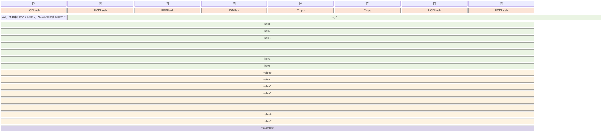

# Go面试题

几个特别值得花时间搞透的模块：
+ **Slice 和 Map**：不只是会用，要知道扩容机制、底层结构、并发安全问题，这两个基本是每场面试必提。
+ **Channel 和并发**：Go 最有特色的地方，Channel 的收发过程、select 的执行机制、各种锁的底层实现，面试官特别喜欢在这里深挖。
+ **GMP 调度模型**：Go 高并发的核心，P 的作用、work-stealing、goroutine 调度时机，这块是 Go 进阶面试的分水岭。
+ GC 垃圾回收：三色标记法、写屏障、STW，理解原理比死记结论重要得多。

## 基础面试题
### 与其他语言相比，使用 Go 有什么好处?

+ Go的语法更简洁。每个功能和语法决策都旨在让程序员的开发效率更高 
+ Golang 针对并发进行了优化，支持协程，并且实现了高效的GMP调度模型
+ 单一的标准代码格式，语法简单，易学，团队协作方便
+ 有高效的垃圾回收机制，支持并行垃圾回收，垃圾回收效率比比 Java 或 Python 更高

### 什么是协程？

协程是用户态轻量级线程，它是线程调度的基本单位。通常在函数前加上 go 关键字就能实现并发。一个 Goroutine 会以一个很小的栈启动（自 Go 1.4 起初始 2KB，早期版本曾为 8KB），当遇到栈空间不足时，栈会自动伸缩，因此可以轻易实现成千上万个 goroutine 同时启动。

#AI，此处的初始2KB查询一下是否为最新版的设定，若不是，指出。

### 协程和线程和进程的区别？

+ 进程：
    + 进程是具有一定独立功能的程序，进程是系统资源分配和调度的最小单位
    + 每个进程都有自己的独立内存空间，不同进程通过进程间通信来通信
    + 由于进程比较重量，占据独立的内存，所以上下文进程间的切换开销（栈、寄存器、虚拟内存、文件句柄等）比较大，但相对比较稳定安全
+ 线程：
    + 线程是进程的一个实体,线程是内核态，而且是 CPU 调度和分派的基本单位,它是比进程更小的能独立运行的基本单位
    + 线程间通信主要通过共享内存，上下文切换很快，资源开销较少，但相比进程不够稳定容易丢失数据
+ 协程：
    + 协程是一种用户态的轻量级线程，协程的调度完全是由用户来控制的。
    + 协程拥有自己的寄存器上下文和栈。 
    + 协程调度切换时，将寄存器上下文和栈保存到其他地方，在切回来的时候，恢复先前保存的寄存器上下文和栈，直接操作栈则基本没有内核切换的开销，可以不加锁的访问全局变量，所以上下文的切换非常快。

#AI，协程此处的其它地方是什么。写入。然后这三种的区别文本可适当优化，并打个表用于快速一览区别。补充无stack协程。

### Golang 中 make 和 new 的区别？

`make` 和 `new` 都是用于内存分配的内建函数，但它们的使用场景和功能有所不同：

+ `make`：
    + 用于初始化并分配内存，只能用于创建 slice、map 和 channel 三种类型。
    + 返回的是初始化后的数据结构，而不是指针。 
+ `new`： 
    + 用于分配内存，但不初始化，返回的是指向该内存的指针。
    + 可以用于任何类型的内存分配。

```go
// 使用 make 创建 slice
s := make([]int, 5) // 创建一个长度为 5 的 slice
fmt.Println(s)      // 输出: [0 0 0 0 0]// 使用 new 创建 int 指针
p := new(int)       // 分配内存给 int 类型
fmt.Println(*p)     // 输出: 0 (初始值)
```

### Golang 中数组和切片的区别？

数组：
+ 数组固定长度。
    + 数组长度是数组类型的一部分，所以[3]int 和[4]int 是两种不同的数组类型
+ 数组需要指定大小，不指定也会根据初始化，自动推算出大小，大小不可改变
+ 数组是通过值传递的

切片: 
+ 切片可以改变长度。
+ 切片是轻量级的数据结构，三个属性：指针、长度、容量
+ 不需要指定大小
+ 切片在传参时按值传递的是 slice header（包含底层数组指针、长度、容量）的副本
    + 因为副本中的指针指向同一底层数组，所以函数内对底层数组元素的修改对调用方可见。
+ 切片可以通过数组来初始化，也可以通过内置函数 make() 来初始化，初始化的时候 len=cap，然后进行扩容
    + cap也可以手动指定

slice 的底层数据其实也是数组，slice 是对数组的封装，它描述一个数组的片段。
slice 实际上是一个结构体，包含三个字段：长度、容量、底层数组。
```go
// runtime/slice.go
type slice struct {
    array unsafe.Pointer // 元素指针
    len   int // 长度 
    cap   int // 容量
}
```

### 使用`for range`的时候，它的地址会发生变化吗？

行为与版本有关。
在1.22版前，for循环提供的是一个地址不变的指针。
1.22版起，改成了一个每次循环都会是新地址的指针。

#AI，这里添加一个新旧版本能有区别的代码示例。

### 如何高效地拼接字符串？

+ `+` 会对字符串进行遍历，计算并开辟一个新的空间来存储原来的两个字符串
+ `fmt.Sprintf` 必须要用反射获取值，因此有性能损耗
+ `strings.Builder` 用WriteString()进行拼接，内部实现是指针+切片，然后将[]byte零拷贝转化为String
+ `bytes.Buffer` 底层也是一个[]byte切片
+ `strings.join` 也是基于strings.builder来实现的,并且可以自定义分隔符。内部会提取计算容量，内存分配高效。

\\(strings.Join \approx strings.Builder\gt bytes.Buffer \gt + \gt fmt.Sprintf\\)

#AI,此处提供一个示例代码

### defer 的执行顺序是怎样的？defer 的作用或者使用场景是什么?

defer执行顺序和调用顺序相反，类似于栈后进先出(LIFO)

#AI，详细的指出return/defer/panic的执行顺序。编写文本和对应的示例代码。同时要指出易错点。

### 什么是rune类型

+ uint8 类型，或者叫 byte 型，代表了 ASCII 码的一个字符
+ rune 类型，代表一个 Unicode 码点（code point），当需要处理中文、日文或者其他非 ASCII 字符时，则需要用到 rune 类型

> rune 是 int32 的别名（UTF-8 是 Go 字符串的底层编码方式，rune 表示的是 Unicode 标量值，两者概念不同）。

### Go 语言 tag 有什么用

#AI，完善下面这段话。使其详细，适合学习

一种软约定，配合go语言的反射功能实现强大的功能。
如：序列化与反序列化、数据库 ORM 映射

### go打印时`%v`\\`%+v`\\`%#v` 的区别

+ `%v` 只输出所有的值
+ `%+v` 先输出字段名字，再输出该字段的值
+ `%#v` 先输出结构体名字值，再输出结构体（字段名字+字段的值）

#AI，编写一个示例Go代码展示

### Go语言中空`struct{}`占用空间么?

可以使用`unsafe.Sizeof`计算出一个数据类型实例需要占用的字节数，空`struct{}`不占用任何空间

### Go语言中，空 `struct{}` 有什么用

+ 模拟Set。`type Set map[string]struct{}`
+ 给通道发信息。`channel<-struct{}{}`
+ 表示仅有方法的结构体。`type Lamp struct{}`

### init() 函数是什么时候执行的?

main()之前

+ init()函数是go初始化的一部分，由runtime初始化每个导入的包，初始化不是按照从上到下的导入顺序，而是按照解析的依赖关系，没有依赖的包最先初始化。
+ 每个包首先初始化包作用域的常量和变量（常量优先于变量）
+ 然后执行包的init()函数。
    + 同一个包，甚至是同一个源文件可以有多个init()函数。
    + init()函数没有入参和返回值，不能被其他函数调用
    + 同一个包内多个init()函数的执行顺序不作保证。
执行顺序：\\(import \rightarrow const \rightarrow var \rightarrow init()\rightarrow main()\\)

#AI，检查描述是否符合最新版本。并绘制一张图描述时序

### 2 个 interface 可以比较吗
+ 若两个都是nil，相等
+ 若只有一个nil，不等
+ 若都非nil
    + 先比较类型
    + 类型相同就看能不能比值

```go
type Stu struct {
     Name string
}

type StuInt interface{}

func main() {
     var stu1, stu2 StuInt = &Stu{"Tom"}, &Stu{"Tom"}
     var stu3, stu4 StuInt = Stu{"Tom"}, Stu{"Tom"}
     fmt.Println(stu1 == stu2) // false
     fmt.Println(stu3 == stu4) // true
}
```

#AI,检查描述，并绘制一个判定流程图。尽可能的新版本go

### 2 个 nil 可能不相等吗

可能不等。interface 内部由 (动态类型 T, 动态值 V) 两部分组成，只有当 T 和 V 都为 nil 时，接口才等于 nil。

把一个类型化的 nil 指针（typed nil，如 (*int)(nil)）装入接口后，接口的动态类型不是 nil，所以接口不等于 nil——这是 Go 中最常见的"nil 陷阱"。举个例子：

```go
func foo() error {
    var err *MyError = nil
    return err
}

if foo() != nil {  // 进入此分支
    // ...
}
```

### Go 语言函数传参是值类型还是引用类型？

+ 在 Go 语言中只存在值传递，要么是值的副本，要么是指针的副本。
    + 无论是值类型的变量还是引用类型的变量亦或是指针类型的变量作为参数传递都会发生值拷贝，开辟新的内存空间
+ 另外值传递、引用传递和值类型、引用类型是两个不同的概念，不要混淆了。引用类型作为变量传递可以影响到函数外部是因为发生值拷贝后新旧变量指向了相同的内存地址。

### 如何知道一个对象是分配在栈上还是堆上？

Go和C++不同，Go局部变量会进行逃逸分析。
    + 如果变量离开作用域后没有被引用，则优先分配到栈上，否则分配到堆上。
    + 那么如何判断是否发生了逃逸呢？`go build -gcflags '-m -m -l' xxx.go`

关于逃逸的可能情况：
+ 变量大小不确定
+ 变量类型不确定
+ 变量分配的内存超过用户栈最大值
+ 暴露给了外部指针。

### Go语言的多返回值是如何实现的

Go 语言的多返回值是通过在函数调用栈帧上预留空间并进行值复制来实现的。

在函数调用发生时，Go 编译器会计算出函数所有返回值的总大小。在为该函数创建栈帧时，就会在调用方（caller）的栈帧上，为这些返回值预留出连续的内存空间。

当函数执行到 return 语句时，它会将其要返回的各个值复制到这些预留好的栈空间中。函数执行完毕后，控制权返回给调用方。此时，调用方可以直接从它自己的栈帧上（即之前为返回值预留的空间）获取这些返回的值。

### Go语言中"_"的作用
+ 忽略多返回值
+ 有时你可能只想执行包的 `init()` 函数（例如，注册驱动、初始化全局变量等），而不需要直接使用包中的任何导出成员。这时，你就可以使用 `_` 来进行匿名导入

### Go语言普通指针和unsafe.Pointer有什么区别？

普通指针比如`*int`、`*string`，它们有明确的类型信息，编译器会进行类型检查和垃圾回收跟踪。
不同类型的指针之间不能直接转换，这是Go类型安全的体现。

而unsafe.Pointer是Go的通用指针类型，可以理解为C语言中的`void*`，它绕过了Go的类型系统。`unsafe.Pointer`可以与任意类型的指针相互转换，也可以与uintptr进行转换来做指针运算。

另外，普通指针受 GC 管理和类型约束，unsafe.Pointer 不受类型约束但仍受 GC 跟踪。

### unsafe.Pointer与uintptr有什么区别和联系

unsafe.Pointer和uintptr可以相互转换，这是Go提供的唯一合法的指针运算方式。典型用法是先将unsafe.Pointer转为uintptr做算术运算，然后再转回unsafe.Pointer使用。

最关键的区别在于GC跟踪。unsafe.Pointer会被垃圾回收器跟踪，它指向的内存不会被错误回收；而uintptr只是一个普通整数，GC完全不知道它指向什么，如果没有其他引用，对应内存可能随时被回收。

所以记住：unsafe.Pointer有GC保护，uintptr没有，这是它们最本质的区别。

#AI,上面这3段话重写并添加`unsafe.Add`的信息

#AI，绘制一个表格对比这3种指针

## slice面试题
### slice的底层结构

slice 的底层数据其实也是数组，slice 是对数组的封装，它描述一个数组的片段。
> slice 实际上是一个结构体，包含三个字段：长度、容量、底层数组。

#AI，绘制一个slice的结构示意图

### Go语言里slice是怎么扩容的？

1.17及以前：
+ 如果期望容量大于当前容量的两倍就会使用期望容量
+ 如果当前切片的容量小于 1024 就会将容量翻倍
+ 如果当前切片的容量大于等于 1024 就会每次增加 25% 的容量，直到新容量大于期望容量

1.18及以后：
+ 当原slice容量(oldcap)小于256的时候，新slice(newcap)容量为原来的2倍
+ 原slice容量超过256，新slice容量newcap = oldcap+(oldcap+3*256)/4

### 从一个切片截取出另一个切片，修改新切片的值会影响原来的切片内容吗

在截取完之后，如果新切片没有触发扩容，则修改切片元素会影响原切片，如果触发了扩容则不会。

```go
package main

import "fmt"

func main() {
	slice := []int{0, 1, 2, 3, 4, 5, 6, 7, 8, 9}
	s1 := slice[2:5]
	s2 := s1[2:6:7]

	s2 = append(s2, 100)
	s2 = append(s2, 200)

	s1[2] = 20

	fmt.Println(s1)
	fmt.Println(s2)
	fmt.Println(slice)
}
```
预期结果：
```bash
[2 3 20]
[4 5 6 7 100 200]
[0 1 2 3 20 5 6 7 100 9]
```

代码详解：

s1 从 slice 索引2（闭区间）到索引5（开区间，元素真正取到索引4），长度为3，容量默认到数组结尾，为8。 
s2 从 s1 的索引2（闭区间）到索引6（开区间，元素真正取到索引5），容量到索引7（开区间，真正到索引6），为5。

#AI，这里绘制slice\s1\s2的示意图，一行一个，左侧是名称，中间是一排方格方有数据，没有数据的不填数据，但是方格要画出来（最好虚化方格） 最右侧标记len=多少，cap=多少

```go
s2 = append(s2,100)
```

s2的容量够，此时，s1和slice也都会被修改。

#AI，这里绘制一个图，与上一个图结构相似，但是重点标记处新增的100（s1和slice上都有100的标记）

```go
s2 = append(s2,200)
```

此时s2的容量不够了，发生了复制扩容，s2的底层数组发生改变。

#AI，绘制一个图，与上一个图结构相似，但是s2和另外两个之间画一个虚线表示分家了，同时重点标记新增的200，100不在重点标记（但是标记出来）

```go
s1[2]=20
```

#AI,在上一个图的基础上重点标记变成20的修改（同理200不在是重点标记）

再提一点，打印 s1 的时候，只会打印出 s1 长度以内的元素。所以，只会打印出3个元素，虽然它的底层数组不止3个元素。

### slice作为函数参数传递，会改变原slice吗？

当 slice 作为函数参数时，因为会拷贝一份新的slice作为实参，所以原来的 slice 结构并不会被函数中的操作改变，也就是说，slice 其实是一个结构体，包含了三个成员：len, cap, array并不会变化。但是需要注意的是，尽管slice结构不会变，但是其底层数组的数据如果有修改的话，则会发生变化。若传的是 slice 的指针，则原 slice 结构会变，底层数组的数据也会变。

这里传递的是一个 slice 的副本，在 f 函数中，s 只是 main 函数中 s 的一个拷贝。在f 函数内部，对 s 的作用并不会改变外层 main 函数的 s的结构。
```go
package main

func main() {
	s := []int{1, 1, 1}
	f(s)
	fmt.Println(s)
}

func f(s []int) {
	for i := range s {
		s[i] += 1
	}
}
```
预期输出
```bash
[2 2 2]
```

要想真的改变外层 slice，只有将返回的新的 slice 赋值到原始 slice，或者向函数传递一个指向 slice 的指针。
```go
package main

import "fmt"

func myAppend(s []int) []int {
	// 这里 s 虽然改变了，但并不会影响外层函数的 s
	s = append(s, 100)
	return s
}

func myAppendPtr(s *[]int) {
	// 会改变外层 s 本身
	*s = append(*s, 100)
	return
}

func main() {
	s := []int{1, 1, 1}
	newS := myAppend(s)

	fmt.Println(s)
	fmt.Println(newS)

	s = newS

	myAppendPtr(&s)
	fmt.Println(s)
}
```
预期输出：
```bash
[1 1 1]
[1 1 1 100]
[1 1 1 100 100]
```

## Map面试题

### Go语言Map的底层实现原理是怎样的

map的就是一个hmap的结构。
+ Go Map的底层实现是一个哈希表。
+ 它在运行时表现为一个指向hmap结构体的指针，hmap中记录了桶数组指针buckets、溢出桶指针以及元素个数等字段。
+ 每个桶是一个bmap结构体，能存储8个键值对和8个tophash，并有指向下一个溢出桶的指针overflow。
+ 为了内存紧凑，bmap中采用的是先存8个键再存8个值的存储方式。

```go
// A header for a Go map.
type hmap struct {
   count     int // map中元素个数
   flags     uint8 // 状态标志位，标记map的一些状态
   B         uint8  // 桶数以2为底的对数，即B=log_2(len(buckets))，比如B=3，那么桶数为2^3=8
   noverflow uint16 //溢出桶数量近似值
   hash0     uint32 // 哈希种子

   buckets    unsafe.Pointer // 指向buckets数组的指针
   oldbuckets unsafe.Pointer // 是一个指向buckets数组的指针，在扩容时，oldbuckets 指向老的buckets数组(大小为新buckets数组的一半)，非扩容时，oldbuckets 为空
   nevacuate  uintptr        // 表示扩容进度的一个计数器，小于该值的桶已经完成迁移

   extra *mapextra // 指向mapextra 结构的指针，mapextra 存储map中的溢出桶
}
```
bmap结构如下：

```mermaid
flowchart LR
    classDef hmap fill:#fdf3e1,stroke:#333,stroke-width:1px
    classDef arr fill:#eaf3fb,stroke:#333,stroke-width:1px
    classDef bmap fill:#eaf4e3,stroke:#333,stroke-width:1px
    classDef extra fill:#ede8f4,stroke:#333,stroke-width:1px
    classDef nil fill:#d95c5c,stroke:#d95c5c,color:#fff

    subgraph HMAP["hmap"]
        direction TB
        h_count["count"]
        h_flags["flags"]
        h_B["B = 5"]
        h_noverflow["noverflow"]
        h_buckets["* buckets"]
        h_oldbuckets["* oldbuckets"]
        h_nevacuate["nevacuate"]
        h_extra["* extra"]
        h_count ~~~ h_flags ~~~ h_B ~~~ h_noverflow ~~~ h_buckets ~~~ h_oldbuckets ~~~ h_nevacuate ~~~ h_extra
        class h_count,h_flags,h_B,h_noverflow,h_buckets,h_oldbuckets,h_nevacuate,h_extra hmap
    end
    
    subgraph BUCKETS["[]bmap"]
        direction TB
        b0["0"]
        b1["1"]
        b2["2"]
        b3["3"]
        b4["4"]
        dots["......"]
        b30["30"]
        b31["31"]
        b0 ~~~ b1 ~~~ b2 ~~~ b3 ~~~ b4 ~~~ dots ~~~ b30 ~~~ b31
        class b0,b1,b2,b3,b4,dots,b30,b31 arr
    end
    
    subgraph BMAP0["bmap"]
        direction TB
        bm0_t["tophash"]
        bm0_k["keys"]
        bm0_v["values"]
        bm0_p["pad"]
        bm0_o["* overflow"]
        bm0_t ~~~ bm0_k ~~~ bm0_v ~~~ bm0_p ~~~ bm0_o
        class bm0_t,bm0_k,bm0_v,bm0_p,bm0_o bmap
    end

    subgraph BMAP1["bmap"]
        direction TB
        bm1_t["tophash"]
        bm1_k["keys"]
        bm1_v["values"]
        bm1_p["pad"]
        bm1_o["* overflow"]
        bm1_t ~~~ bm1_k ~~~ bm1_v ~~~ bm1_p ~~~ bm1_o
        class bm1_t,bm1_k,bm1_v,bm1_p,bm1_o bmap
    end

    subgraph BMAP2["bmap"]
        direction TB
        bm2_t["tophash"]
        bm2_k["keys"]
        bm2_v["values"]
        bm2_p["pad"]
        bm2_o["* overflow"]
        bm2_t ~~~ bm2_k ~~~ bm2_v ~~~ bm2_p ~~~ bm2_o
        class bm2_t,bm2_k,bm2_v,bm2_p,bm2_o bmap
    end

    subgraph BMAP3["bmap"]
        direction TB
        bm3_t["tophash"]
        bm3_k["keys"]
        bm3_v["values"]
        bm3_p["pad"]
        bm3_o["* overflow"]
        bm3_t ~~~ bm3_k ~~~ bm3_v ~~~ bm3_p ~~~ bm3_o
        class bm3_t,bm3_k,bm3_v,bm3_p,bm3_o bmap
    end

    subgraph EXTRA["mapextra"]
        direction TB
        me_o["overflow"]
        me_n["nextoverflow"]
        me_o ~~~ me_n
        class me_o,me_n extra
    end
    
    NIL(("nil")):::nil
    
    h_buckets --> BUCKETS
    h_extra --> EXTRA
    
    b0 --> BMAP0
    b1 --> BMAP2
    b4 --> BMAP3
    
    bm0_o --> BMAP1
    bm1_o --> NIL
    
    bm2_o --> NIL
    bm3_o --> NIL
```




### Go语言Map的遍历是有序的还是无序的

Go语言里Map的遍历是完全随机的，并没有固定的顺序。map每次遍历,都会从一个随机值序号的桶,在每个桶中，再从按照之前选定随机槽位开始遍历,所以是无序的。

### Go语言Map的遍历为什么要设计成无序的

Go团队为了避免开发者写出依赖底层实现细节的脆弱代码，而有意为之的一个设计。

通过在遍历时引入随机数，Go从根本上杜绝了程序员依赖特定遍历顺序的可能性，强制我们写出更健壮的代码。

### Map如何实现顺序读取

如果业务上确实需要有序遍历，最规范的做法就是将Map的键（Key）取出来放入一个切片（Slice）中，用sort包对切片进行排序，然后根据这个有序的切片去遍历Map。

### Go语言的Map是否是并发安全的

在 Go 的 map 实现中，查找、赋值、遍历和删除等操作都会检测 `hashWriting` 写标志。其中，查找和遍历只检测该标志而不置位；赋值和删除在确认写标志未置位后，会先将该标志置位，再执行后续操作，并在写操作结束前检查并清除该标志。若任一操作检测到写标志已被置位，说明当前已有 goroutine 正在对该 map 执行写操作（赋值或删除），此时会直接调用 `throw`，触发 runtime fatal error；该错误不可被 `recover` 捕获。

### Map的Key一定要是可比较的吗？为什么？

不同的Key可能会产生相同的哈希值，这就是"哈希冲突"。
当多个Key被定位到同一个"桶"里时，Map就没法只靠哈希值来区分它们了。
此时，它必须在桶内进行逐个遍历，用我们传入的Key和桶里已有的每一个Key进行**相等**比较。
这样才能确保我们操作的是正确的键值对。

### Go语言Map的扩容时机是怎样的？

向 map 插入新 key 的时候，会进行条件检测，符合下面这 2 个条件，就会触发扩容：
+ 装载因子超过阈值（源码里定义的阈值是 6.5），触发双倍扩容（B+1，buckets 数量翻倍）。
+ overflow 的 bucket 数量过多（触发等量扩容，B 不变，仅重新整理键值对让分布更紧凑）：
    + 当 \\(B\lt 15\\)，也就是 bucket 总数 \\(2^B\lt 2^{15}\\) 时，如果 overflow 的 bucket 数量超过 \\(2^B\\)
    + 当 \\(B \geq 15\\)，也就是 bucket 总数 \\(2^B\\) 大于等于 \\(2^{15}\\)，如果 overflow 的 bucket 数量超过 \\(2^{15}\\)。

### Go语言Map的扩容过程是怎样的？
Go的扩容是渐进式（gradual）的。

它不会在触发扩容时"stop the world"来一次性把所有数据搬迁到新空间，而是只分配新空间，然后在后续的每一次插入、修改或删除操作时，才会顺便搬迁一两个旧桶的数据。这种设计将庞大的扩容成本分摊到了多次操作中，极大地减少了服务的瞬间延迟（STW），保证了性能的平滑性。

+ 如果是触发双倍扩容，会新建一个buckets数组，新的buckets数量大小是原来的2倍，然后旧buckets数据搬迁到新的buckets。
+ 如果是等量扩容，buckets数量维持不变，重新做一遍类似双倍扩容的搬迁动作，把松散的键值对重新排列一次，使得同一个 bucket 中的 key 排列地更紧密，这样节省空间，存取效率更高

### 可以对Map的元素取地址吗

不行

### Map 中删除一个 key，它的内存会释放么
不会，delete一个key，并不会立刻释放或收缩Map占用的内存。

具体来说，delete(m, key) 这个操作，只是把key和value对应的内存块标记为"空闲"，让它们的内容可以被后续的垃圾回收（GC）处理掉。

但是，Map底层为了存储这些键值对而分配的"桶"（buckets）数组，它的规模是不会缩小的。
只有当 map 失去所有引用（被置为 nil 或离开作用域）后，整个 map 的空间才会被垃圾回收后释放。

### Map可以边遍历边删除吗

在单个goroutine里可以，但结果是不确定的。

## Channel面试题

### 什么是CSP