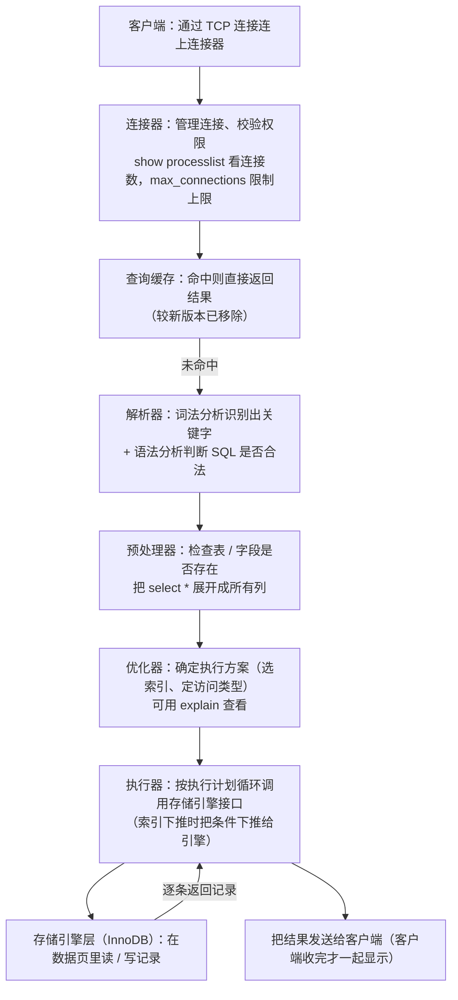
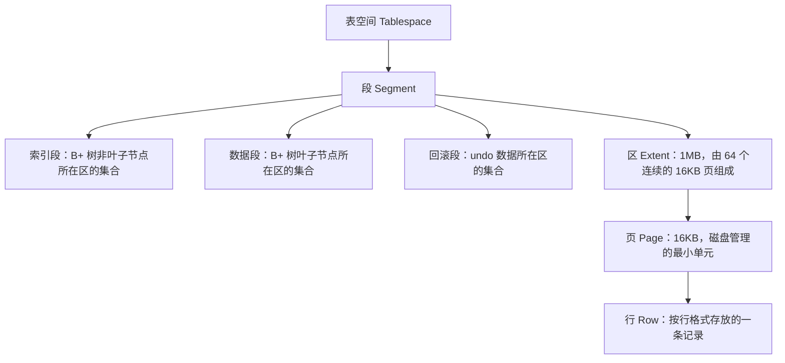
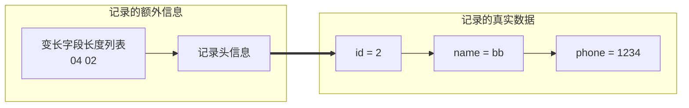
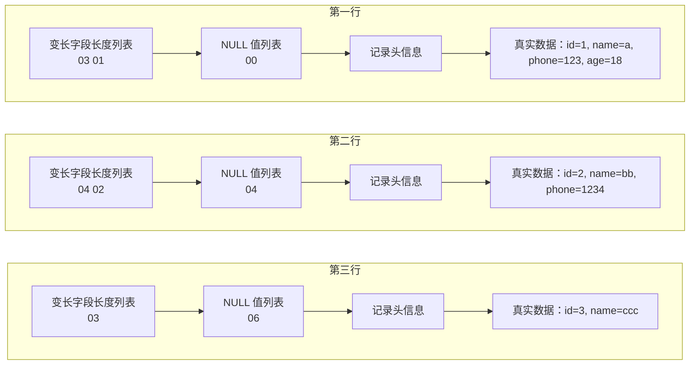

# 基础

本章回答两个问题：**一条 SQL 是怎么被执行的**，以及**数据在磁盘上是怎么存的**。默认讨论 MySQL 的 InnoDB 引擎。

+ **执行链路**：连接器 →（旧版本的查询缓存）→ 解析器 → 预处理器 → 优化器 → 执行器 → 存储引擎。Server 层负责建立连接、分析和执行 SQL，存储引擎层负责数据的存储和提取。
    + 表、字段是否存在由**预处理器**检查（MySQL 5.7 是在词法 / 语法分析之后、prepare 之前做的），`select *` 的 `*` 也在这里展开成表上的所有列。
    + 走哪个索引、用哪种访问类型由**优化器**决定，`explain` 看到的就是它的结论。
    + **执行器**按执行计划在一个 while 循环里反复调用存储引擎的读写接口，逐条把记录返回给客户端；索引下推时，部分条件下推给存储引擎先过滤。
+ **存储层级**：表空间 → 段（索引段 / 数据段 / 回滚段）→ 区（1MB，即 64 个连续的 16KB 页）→ 页（16KB，磁盘管理的最小单元）→ 行。大数据量时按区分配、让相邻页在磁盘上也相邻，是为了把随机 I/O 变成顺序 I/O。
+ **行格式**：Redundant → Compact → Dynamic / Compressed，MySQL 5.7 起默认 Dynamic。Compact 由「变长字段长度列表 + NULL 值列表 + 记录头信息」三段额外信息加真实数据（`row_id` / `trx_id` / `roll_pointer` + 各列的值）组成；前两段只在需要时才出现，且都按**逆序**存放，为的是让真实数据与对应的长度 / NULL 信息落在同一个 CPU Cache Line 里。
+ **长度上限**：除 TEXT、BLOB 这类大对象外，所有列（不含隐藏列与记录头信息）加上变长字段长度列表、NULL 值列表占用的字节，总和不能超过 `2^16-1=65535` 字节，这也是 `varchar(n)` 中 n 上限的来源。
+ **行溢出**：Compact 在行内保留一部分数据，再用 20 字节存指向溢出页的地址；Dynamic / Compressed 不存部分数据，整行数据都放溢出页，只留这 20 字节。

## 执行SQL的过程

一条 SQL 从客户端进来，到存储引擎把记录取出来，整条链路如下：



+ Server 层负责建立连接、分析和执行 SQL
+ 存储引擎层负责数据的存储和提取

### 连接器
客户端使用TCP来与连接器连接。

如果一个用户已经建立了连接，即使管理员中途修改了该用户的权限，也不会影响已经存在连接的权限。
修改完成后，只有再新建的连接才会使用新的权限设置。

+ `show processlist`可以查看连接数
+ 空闲连接默认最多8小时
+ MySQL 服务支持的最大连接数由 max_connections 参数控制
+ MySQL 的连接也跟 HTTP 一样，有短连接和长连接的概念


长连接占用内存较多，解决方案：
+ 定期断开长连接
+ 客户端主动重置连接

### 查询缓存

较新版本已被移除。

### 解析SQL

1. 词法分析
    + 识别出关键字出来
2. 语法分析
    + 判断你输入的这个 SQL 语句是否满足 MySQL 语法

> 表不存在或者字段不存在，并不是在解析器里做的

### 执行SQL

分为三个阶段：
+ prepare 阶段，也就是预处理阶段
+ optimize 阶段，也就是优化阶段
+ execute 阶段，也就是执行阶段

#### 预处理器
+ 检查 SQL 查询语句中的表或者字段是否存在
+ 将 select * 中的 * 符号，扩展为表上的所有列

> 对于 MySQL 5.7 判断表或字段是否存在的工作，是在词法分析和语法分析之后，prepare 阶段之前做的

#### 优化器

优化器主要负责将 SQL 查询语句的执行方案确定下来。

`explain`命令可以查询优化器决定的执行方案。

#### 执行器

以下面三种为例
+ 主键索引查询：`SELECT * FROM product WHERE id=1;`
    + 执行器第一次查询，会调用 read_first_record 函数指针指向的函数，因为优化器选择的访问类型为 const，这个函数指针被指向为 InnoDB 引擎索引查询的接口，把条件 id = 1 交给存储引擎，让**存储引擎定位**符合条件的第一条记录。
    + 存储引擎通过主键索引的 B+ 树结构定位到 id = 1的第一条记录，如果记录是不存在的，就会向执行器上报记录找不到的错误，然后查询结束。如果记录是存在的，就会将记录返回给执行器；
    + 执行器从存储引擎读到记录后，接着判断记录是否符合查询条件，如果符合则发送给客户端，如果不符合则跳过该记录。
    + 执行器查询的过程是一个 **while 循环**，所以**还会再查一次**，但是这次因为不是第一次查询了，所以会调用 read_record 函数指针指向的函数，因为优化器选择的访问类型为 const，这个函数指针被指向为一个永远返回 - 1 的函数，所以当调用该函数的时候，执行器就退出循环，也就是结束查询了。
+ 全表扫描：`SELECT * FROM product WHERE name='iphone';`
    + 执行器第一次查询，会调用 read_first_record 函数指针指向的函数，因为优化器选择的访问类型为 all，这个函数指针被指向为 InnoDB 引擎全扫描的接口，让存储引擎读取表中的第一条记录；
    + 执行器会判断读到的这条记录的 name 是不是 iphone，如果不是则跳过；如果是则将记录发给客户的
        + 是的没错，**Server 层每从存储引擎读到一条记录就会发送给客户端**，之所以客户端显示的时候是直接显示所有记录的，是因为客户端是等查询语句查询完成后，才会显示出所有的记录。
    + 执行器查询的过程是一个 while 循环，所以还会再查一次，会调用 read_record 函数指针指向的函数，因为优化器选择的访问类型为 all，read_record 函数指针指向的还是 InnoDB 引擎全扫描的接口，所以接着向存储引擎层要求继续读刚才那条记录的下一条记录，存储引擎把下一条记录取出后就将其返回给执行器（Server层），执行器继续判断条件，不符合查询条件即跳过该记录，否则发送到客户端；
    + 一直重复上述过程，直到存储引擎把表中的所有记录读完，然后向执行器（Server层） 返回了读取完毕的信息；
    + 执行器收到存储引擎报告的查询完毕的信息，退出循环，停止查询。
+ 索引下推：`SELECT * FROM t_user WHERE age>20 AND reward=100000;// 联合索引（age，reward)`
    + 索引下推就是在定位到age>20的索引时，将判断reward=100000的任务交给存储引擎而不是交给Server层

## 存储记录的模式

本书默认讨论的是MySQL的InnoDB引擎的行为。

### 数据存放在哪个文件？

+ *.opt，用来存储当前数据库的默认字符集和字符校验规则。
+ *.frm ，表结构会保存在这个文件。
    + 在 MySQL 中建立一张表都会生成一个.frm 文件，该文件是用来保存每个表的元数据信息的，主要包含表结构定义。 
+ *.ibd，表数据会保存在这个文件。
    + 表数据既可以存在共享表空间文件里，也可以存放在独占表空间文件（文件名：表名字.ibd）。
        + 这个行为是由参数 innodb_file_per_table 控制的，若设置了参数 innodb_file_per_table 为 1，则会将存储的数据、索引等信息单独存储在一个独占表空间，从 MySQL 5.6.6 版本开始，它的默认值就是 1 了，因此从这个版本之后， MySQL 中每一张表的数据都存放在一个独立的 .ibd 文件。

### 表空间文件的结构是怎么样的？

+ 表空间（Tablespace）
    + 段（Segment）
        + 区（Extent）
            + 页（Page）
                + 行（Row）



1. 表空间是由各个段（segment）组成的
    + 索引段：存放 B + 树的非叶子节点的区的集合
    + 数据段：存放 B + 树的叶子节点的区的集合
    + 回滚段：存放的是回滚数据的区的集合，用于[事务隔离](./事务篇.md#read-view-在-mvcc-里如何工作的)
2. 区（extent）：顺序化
    + InnoDB 存储引擎是用 B+ 树来组织数据的
        + B+ 树中每一层都是通过双向链表连接起来的，那么磁盘查询时就会有大量的随机I/O
    + 在表中数据量大的时候，为某个索引分配空间的时候就不再按照页为单位分配了，而是按照区（extent）为单位分配。
        + 每个区的大小为 1MB，对于  16KB 的页来说，连续的 64 个页会被划为一个区，这样就使得链表中相邻的页的物理位置也相邻，就能使用**顺序 I/O **了。
3. 页（page）：读取单位
    + 记录是按照行来存储的，但是数据库的读取并不以**行**为单位
    + InnoDB 的数据是按**页**为单位来读写的
    + 默认每个页的大小为 16KB
    + 页是 InnoDB 存储引擎磁盘管理的最小单元
    + 页的类型有很多，常见的有数据页、undo 日志页、溢出页等等
4. 行（row）
    + 数据库表中的记录都是按行（row）进行存放的，每行记录根据不同的行格式，有不同的存储结构

### InnoDB 行格式有哪些

+ Redundant 是很古老的行格式了， MySQL 5.0 版本之前用的行格式，现在基本没人用了。
+ 由于 Redundant 不是一种紧凑的行格式，所以 MySQL 5.0 之后引入了 Compact 行记录存储方式
    + Compact 是一种紧凑的行格式，设计的初衷就是为了让一个数据页中可以存放更多的行记录
    + 从 MySQL 5.1 版本之后，行格式默认设置成 Compact
+ Dynamic 和 Compressed 两个都是紧凑的行格式，它们的行格式都和 Compact 差不多，因为都是基于 Compact 改进一点东西
    + 从 MySQL5.7 版本之后，默认使用 Dynamic 行格式。

### COMPACT 行格式长什么样？


「必有 / 非必有」表示这一段是否每次都要写进记录：记录头信息、`trx_id`、`roll_pointer` 一定存在（依次占 5 / 6 / 7 字节）；有变长字段才有变长字段长度列表，有允许 NULL 的列才有 NULL 值列表，没有主键 / 唯一约束列才有 `row_id`（6 字节）。

#### 记录的额外信息

变长字段长度列表：
在存储数据的时候，也要把变长数据所占用的大小存起来，存到**变长字段长度列表**里面

假设表为
```SQL
CREATE TABLE `t_user` (
    `id` int(11) NOT NULL,
    `name` VARCHAR(20) DEFAULT NULL,
    `phone` VARCHAR(20) DEFAULT NULL,
    `age` int(11) DEFAULT NULL,
    PRIMARY KEY (`id`) USING BTREE
) ENGINE = InnoDB DEFAULT CHARACTER SET = ascii ROW_FORMAT = COMPACT;
```

表里的数据如下：

| id | name | phone | age |
|---|---|---|---|
| 1 | a | 123 | 18 |
| 2 | bb | 1234 | NULL |
| 3 | ccc | NULL | NULL |


对于第一行
+ a占用的字节数是1字节，0x01
+ 123占用的是3字节,0x03
+ age和id不是变长的，不管

变长字段所占用的字节数，按逆序排列。


每行都有的 `trx_id`、`roll_pointer` 这里省略；`id` 是主键，所以这一行也没有 `row_id`。此时还未引入 NULL 值列表。

同理第二行如下图所示



`age` 为 NULL，所以真实数据里没有它（`trx_id`、`roll_pointer` 同样省略）。

由于第三行的phone是NULL，因此它只有一个 03


`phone`、`age` 均为 NULL，所以真实数据只到 `name`（`trx_id`、`roll_pointer` 同样省略）。

> 为什么「变长字段长度列表」的信息要按照逆序存放？
>
> 这个设计是有想法的，主要是因为「记录头信息」中指向下一个记录的指针，指向的是下一条记录的「记录头信息」和「真实数据」之间的位置，这样的好处是向左读就是记录头信息，向右读就是真实数据，比较方便。
> 「变长字段长度列表」中的信息之所以要逆序存放，是因为这样可以使得位置靠前的记录的真实数据和数据对应的字段长度信息可以同时在一个 CPU Cache Line 中，这样就可以提高 CPU Cache 的命中率。
>
> 同样的道理，NULL值列表的信息也是逆序存放的


当数据表没有变长字段的时候，比如全部都是 int 类型的字段，这时候表里的行格式就不会有「变长字段长度列表」了，因为没必要，不如去掉以节省空间。

NULL值列表：
如果把这些 NULL 值都放到记录的真实数据中会比较浪费空间，所以 Compact 行格式把这些值为 NULL 的列存储到 NULL值列表中。

如果允许存在NULL列，则每列对应一个二进制位bit，二进制位按照列的顺序逆序排列。
+ 1为该列为NULL
+ 0为该列不为NULL

另外，NULL 值列表必须用整数个字节的位表示（1字节8位），如果使用的二进制位个数不足整数个字节，则在字节的高位补 0。

+ 第一行，其NULL值表为 0000,0000（age,phone,name）
+ 第二行，其NULL值表为 0000,0100
+ 第三行，其NULL值表为 0000,0110



三行的差别都在两段逆序信息上：`phone`（3 / 4 字节）的长度写在 `name`（1 / 2 字节）之前，所以变长字段长度列表是 `03 01`、`04 02`、`03`；NULL 值列表随「哪些列是 NULL」变化——`00` 表示没有 NULL，`04` 表示只有 `age` 为 NULL（第二行），`06` 表示 `phone` 与 `age` 都为 NULL（第三行）。

NULL 值列表也不是必须的。
当数据表的字段都定义成 NOT NULL 的时候，这时候表里的行格式就不会有 NULL 值列表了。

那么可以通关建立一个全NOT NULL的列表来省空间。

记录头信息：内容较多，较为重要的有
+ delete_mask：标识是否已经删除，已经删除的为1
+ next_record：下一条记录的位置
+ record_type：表示当前记录的类型，0表示普通记录，1表示B+树非叶子节点记录，2表示最小记录，3表示最大记录

#### 记录的真实数据

+ row_id：不一定有，只有当没有主键或者唯一约束列时才存在，存在时占用6字节
+ trx_id：表示是哪个事务生成的。必须存在，6字节
+ roll_pointer：记录上一个版本的指针。必须存在，7字节。

详情见[MVCC](./事务篇.md#read-view-在-mvcc-里如何工作的)

### varchar(n) 中 n 最大取值为多少

MySQL 规定**除了 TEXT、BLOBs 这种大对象类型之外**，其他所有的列（不包括隐藏列和记录头信息）占用的字节长度加起来不能超过 \\(2^{16}-1=65535\\) 个字节。

```SQL
CREATR TABLE test (
    `name` VARCHAR(65532) NULL
) ENGINE = InnoDB DEFAULT CHARACTER SET = ascii ROW_FORMAT = COMPACT;
```

像示例只有一个varchar字段的情况下，分为3部分
+ 真实数据：\\(65535-1-2=65532\\)
+ 真实数据占用的字节数，2字节（变长字段存储的最大字节数小于等于255就是1字节）
+ NULL标识，1字节


如果是多字段，那么要保证\\(所有字段的长度 + 变长字段字节数列表所占用的字节数 + NULL值列表所占用的字节数 \leq 65535\\)

### 行溢出后，MySQL是怎么处理的

溢出的数据会被放入溢出页中。
对于Compact，先存一部分在行中，最好深20字节存指向剩余数据的地址。

Compressed 和 Dynamic 这两个行格式和 Compact 非常类似，主要的区别在于处理行溢出数据时有些区别。
这两种格式不会存部分数据到行中，而且全部存在溢出页，地址还是20字节
