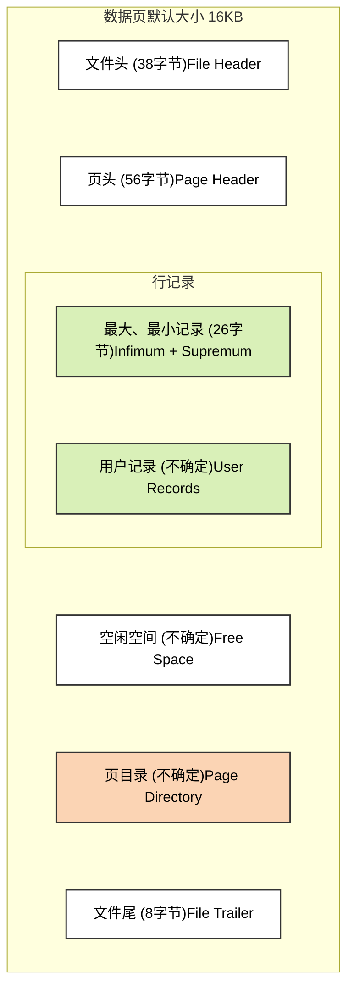

# 索引

#AI，做个总结

## 索引常见面试题

### 索引的分类

+ 按「数据结构」分类：B+tree索引、Hash索引、Full-text索引。
+ 按「物理存储」分类：聚簇索引（主键索引）、二级索引（辅助索引）。
+ 按「字段特性」分类：主键索引、唯一索引、普通索引、前缀索引。
+ 按「字段个数」分类：单列索引、联合索引。

#### 按数据结构分类
从数据结构的角度来看，MySQL 常见索引有 B+Tree 索引、HASH 索引、Full-Text 索引。

InnoDB的索引创建规则：
+ 如果有主键，默认会使用主键作为聚簇索引的索引键（key）
+ 如果没有主键，就选择第一个不包含 NULL 值的唯一列作为聚簇索引的索引键（key）
+ 在上面两个都没有的情况下，InnoDB 将自动生成一个隐式自增 id 列作为聚簇索引的索引键（key）

其它索引都属于辅助索引（Secondary Index），也被称为二级索引或非聚簇索引。
创建的主键索引和二级索引默认使用的是 B+Tree 索引。
```sql
CREATE TABLE `product` (
  `id` int(11) NOT NULL,
  `product_no` varchar(20) DEFAULT NULL,
  `name` varchar(255) DEFAULT NULL,
  `price` decimal(10,2) DEFAULT NULL,
  PRIMARY KEY (`id`) USING BTREE
) CHARACTER SET = utf8 COLLATE = utf8_general_ci ROW_FORMAT = Dynamic;
```
使用的数据如下：

| id | product_no | name | price |
| :--- | :--- | :--- | :--- |
| 1 | 0001 | apple | 6.00 |
| 2 | 0002 | banana | 2.00 |
| 3 | 0003 | orange | 3.00 |
| 4 | 0004 | iphone13 | 5000.00 |
| 5 | 0005 | ipad8 | 3500.00 |
| 6 | 0006 | macbookpro | 10000.00 |
| 7 | 0007 | ps5 | 4000.00 |
| 8 | 0008 | grape | 10.00 |
| 9 | 0009 | watermelon | 40.00 |
| 10 | 0010 | mango | 8.00 |

B+Tree 是一种多叉树，叶子节点才存放数据，非叶子节点只存放索引，而且每个节点里的数据是按主键顺序存放的。

每一层父节点的索引值都会出现在下层子节点的索引值中，因此在叶子节点中，包括了所有的索引值信息，并且每一个叶子节点都有两个指针，分别指向下一个叶子节点和上一个叶子节点，形成一个双向链表。

#AI，绘制一个B+树，采用上面的数据。

如果查询二级索引product_no
```sql
select * from product where product_no = '0002';
```
会先检二级索引中的 B+Tree 的索引值（商品编码，product_no），找到对应的叶子节点，然后获取主键值，然后再通过主键索引中的 B+Tree 树查询到对应的叶子节点，然后获取整行数据。这个过程叫「回表」，也就是说要查两个 B+Tree 才能查到数据。如下图：

#AI，绘制个图

不过，当查询的数据是能在二级索引的 B+Tree 的叶子节点里查询到，这时就不用再查主键索引查，比如下面这条查询语句：
```bash
select id from product where product_no = '0002';
```
这种在二级索引的 B+Tree 就能查询到结果的过程就叫作「覆盖索引」，也就是只需要查一个 B+Tree 就能找到数据。

B+Tree的选择理由：
+ B+Tree vs B Tree：单节点数据量少，双链表适合顺序查找
    + B+Tree 只在叶子节点存储数据，而 B 树 的非叶子节点也要存储数据，所以 B+Tree 的单个节点的数据量更小，在相同的磁盘 I/O 次数下，就能查询更多的节点。
    + 另外，B+Tree 叶子节点采用的是双链表连接，适合 MySQL 中常见的基于范围的顺序查找，而 B 树无法做到这一点。
+ B+Tree vs 二叉树：层数少
    + 对于有 N 个叶子节点的 B+Tree，其搜索复杂度为O(logdN)，其中 d 表示节点允许的最大子节点个数为 d 个。
    + 在实际的应用当中， d 值是大于100的，这样就保证了，即使数据达到千万级别时，B+Tree 的高度依然维持在 3~4 层左右，也就是说一次数据查询操作只需要做 3~4 次的磁盘 I/O 操作就能查询到目标数据。
    + 而二叉树的每个父节点的儿子节点个数只能是 2 个，意味着其搜索复杂度为 O(logN)，这已经比 B+Tree 高出不少，因此二叉树检索到目标数据所经历的磁盘 I/O 次数要更多。
+ B+Tree vs Hash：适合范围查找
    + Hash 在做等值查询的时候效率贼快，搜索复杂度为 O(1)。
    + 但是 Hash 表不适合做范围查询，它更适合做等值的查询，这也是 B+Tree 索引要比 Hash 表索引有着更广泛的适用场景的原因。

#### 按物理存储分类
从物理存储的角度来看，索引分为聚簇索引（主键索引）、二级索引（辅助索引）。
+ 主键索引的 B+Tree  的叶子节点存放的是实际数据，所有完整的用户记录都存放在主键索引的 B+Tree 的叶子节点里
+ 二级索引的 B+Tree  的叶子节点存放的是主键值，而不是实际数据。

> 在查询时使用了二级索引，如果查询的数据能在二级索引里查询的到，那么就不需要回表

#### 按字段特性分类
从字段特性的角度来看，索引分为主键索引、唯一索引、普通索引、前缀索引。
+ 主键索引：主键索引就是建立在主键字段上的索引，通常在创建表的时候一起创建，一张表最多只有一个主键索引，索引列的值不允许有空值。
+ 唯一索引：唯一索引建立在 UNIQUE 字段上的索引，一张表可以有多个唯一索引，索引列的值必须唯一，但是允许有空值。
+ 普通索引：普通索引就是建立在普通字段上的索引，既不要求字段为主键，也不要求字段为 UNIQUE。
+ 前缀索引：前缀索引是指对字符类型字段的前几个字符建立的索引，而不是在整个字段上建立的索引，前缀索引可以建立在字段类型为 char、 varchar、binary、varbinary 的列上。
    + 使用前缀索引的目的是为了减少索引占用的存储空间，提升查询效率。

#### 按字段个数分类
从字段个数的角度来看，索引分为单列索引、联合索引（复合索引）。
+ 建立在单列上的索引称为单列索引，比如主键索引
+ 建立在多列上的索引称为联合索引
    + 使用联合索引时，存在最左匹配原则，也就是按照最左优先的方式进行索引的匹配。
    + 如果不遵循「最左匹配原则」，联合索引会失效，这样就无法利用到索引快速查询的特性了

假如创建了`(a,b,c)`联合索引，以下可以用上联合索引
+ where a=1
+ where a=1 and b=2 and c=3
+ where a=1 and b=2
> 存在优化器，a的位置不重要

但是下面的会失效
+ where b=2
+ where c=3
+ where b=2 and c=3

上面这些查询条件之所以会失效，是因为`(a, b, c)` 联合索引，是先按 a 排序，在 a 相同的情况再按 b 排序，在 b 相同的情况再按 c 排序。

联合索引有一些特殊情况，并不是查询过程使用了联合索引查询，就代表联合索引中的所有字段都用到了联合索引进行索引查询，也就是可能存在部分字段用到联合索引的 B+Tree，**部分字段没有用到联合索引的 B+Tree 的情况**。

例如 `select * from t_table where a > 1 and b = 2`，联合索引（a, b）。
+ a使用了联合索引
+ b没有使用

例如 `select * from t_table where a >= 1 and b = 2`，联合索引（a, b）。
+ a=1时，b用了联合索引
+ a>1时，b没有使用
+ a使用了联合索引

例如: `SELECT * FROM t_table WHERE a BETWEEN 2 AND 8 AND b = 2`，联合索引（a, b）。

+ 在MySQL中between包含两端
+ 因此a,b用上了联合索引（用上了不代表全部用上了，在MySQL的查询计划是这样的）

例如`SELECT * FROM t_user WHERE name like 'j%' and age = 22`，联合索引（name, age）
+ 当name='j'时，age有序
+ 当name为别的内容时，age无序
+ 因此用上了联合索引

综上所示，联合索引的最左匹配原则，在遇到范围查询（如 \\(\gt\\)、\\(\lt\\)）的时候，就会停止匹配，也就是范围查询的字段可以用到联合索引，但是在范围查询字段的后面的字段无法用到联合索引。注意，对于  \\(\geq\\)、\\(\leq\\)、BETWEEN、like 前缀匹配的范围查询，并不会停止匹配，前面我也用了四个例子说明了。

索引下推：
+ 在 MySQL 5.6 之前，只能从 ID2 （主键值）开始一个个回表，到「主键索引」上找出数据行，再对比 b 字段值。
+ 而 MySQL 5.6 引入的索引下推优化（index condition pushdown）， 可以在联合索引遍历过程中，对联合索引中包含的字段先做判断，直接过滤掉不满足条件的记录，减少回表次数。

索引区分度：
+ 区分度是设计索引的参考因素，但不能仅按区分度高低排列字段，还要结合实际 SQL 的过滤条件、排序需求和最左前缀的复用情况。
\\[区分度=\frac{distinct(column)}{count(*)}\\]

比如，性别这类字段的区分度通常较低；如果数据分布均匀，仅按性别过滤往往仍会命中大量记录，单列索引的收益可能有限。
UUID 通常具有很高的区分度，适合按具体 UUID 定位少量记录，但这并不意味着它一定适合作为主键，或一定应该排在联合索引的最前面。

**区分度高，不等于写入成本低**。随机 UUID（例如 UUIDv4）作为索引键时，新记录的插入位置会分散在 B+ 树的不同页面，可能增加随机页访问和页分裂开销；聚簇索引和二级索引都需要考虑这一点。
如果把 UUID 用作主键，还要考虑主键值会被存入各个二级索引，较长的主键会增加它们的空间开销。

是否使用索引，最终取决于优化器估算的成本。
+ 当条件命中大量记录且需要频繁回表时，全表扫描可能更划算
+ 而覆盖索引、排序需求、数据分布等因素也会影响选择，不能用固定的**30%**作为是否走索引的判断界线。

联合索引进行排序：
例如`SELECT * FROM order WHERE status=1 ORDER BY create_time asc`

比较好的方式是创建一个（status,create_time）联合索引。这样可以避免单独status索引时的排序。

### 什么时候需要 / 不需要创建索引

索引的缺点：
+ 需要占用物理空间，数量越大，占用空间越大
+ 创建索引和维护索引要耗费时间，这种时间随着数据量的增加而增大
+ 会降低表的增删改的效率，因为每次增删改索引，B+ 树为了维护索引有序性，都需要进行动态维护。

索引适用场景：
+ 字段有唯一性限制的，比如商品编码
+ 经常用于 **WHERE** 查询条件的字段，这样能够提高整个表的查询速度，如果查询条件不是一个字段，可以建立联合索引。
+ 经常用于 **GROUP BY 和 ORDER BY** 的字段，这样在查询的时候就不需要再去做一次排序了，因为我们都已经知道了建立索引之后在 B+Tree 中的记录都是排序好的。

非适用场景：
+ WHERE 条件，GROUP BY，ORDER BY 里用不到的字段，索引的价值是快速定位，如果起不到定位的字段通常是不需要创建索引的，因为索引是会占用物理空间的。
+ 字段中存在大量重复数据，不需要创建索引
    + 比如性别字段，只有男女，如果数据库表中，男女的记录分布均匀，那么无论搜索哪个值都可能得到一半的数据。
    + 在这些情况下，还不如不要索引，因为 MySQL 还有一个查询优化器，查询优化器发现某个值出现在表的数据行中的百分比很高的时候，它一般会忽略索引，进行全表扫描。
+ 表数据太少的时候，不需要创建索引
+ **经常更新**的字段不用创建索引，比如不要对电商项目的用户余额建立索引，因为索引字段频繁修改，由于要维护 B+Tree的有序性，那么就需要频繁的重建索引，这个过程是会影响数据库性能的。

### 优化索引的方法

前缀索引优化：使用前缀索引是为了减小索引字段大小，可以增加一个索引页中存储的索引值，有效提高索引的查询速度。在一些大字符串的字段作为索引时，使用前缀索引可以帮助我们减小索引项的大小。
+ order by 就无法使用前缀索引
+ 无法把前缀索引用作覆盖索引

覆盖索引优化：覆盖索引是指 SQL 中 query 的所有字段，在索引 B+Tree  的叶子节点上都能找得到的那些索引，从二级索引中查询得到记录，而不需要通过聚簇索引查询获得，可以避免回表的操作。
+ 好处是减少了I/O操作

主键索引最好是自增的：
+ 减少移动数据，减少树分裂

索引最好设置为NOT NULL：
+ 索引列存在 NULL 就会导致优化器在做索引选择的时候更加复杂，更加难以优化，因为可为 NULL 的列会使索引、索引统计和值比较都更复杂，比如进行索引统计时，count 会省略值为NULL 的行。
+ NULL 值是一个没意义的值，但是它会占用物理空间，所以会带来的存储空间的问题，因为 InnoDB 存储记录的时候，如果表中存在允许为 NULL 的字段，那么行格式  (opens new window)中至少会用 1 字节空间存储 NULL 值列表

索引失效：
+ 当我们使用左或者左右模糊匹配的时候，也就是 like %xx 或者 like %xx%这两种方式都会造成索引失效
+ 当我们在查询条件中对索引列做了计算、函数、类型转换操作，这些情况下都会造成索引失效
+ 联合索引要能正确使用需要遵循最左匹配原则，也就是按照最左优先的方式进行索引的匹配，否则就会导致索引失效。
+ 在 WHERE 子句中，如果在 OR 前的条件列是索引列，而在 OR 后的条件列不是索引列，那么索引会失效。

## 数据页角度看B+树

### InnoDB 是如何存储数据的

InnoDB 的数据是按「数据页」为单位来读写的。
InnoDB 数据页的默认大小是 16KB。


#AI，优化绘图，使其上下更加紧凑，看起来更像是一个数据结构示意图，配色可以修改，但是要体现分组，分组也可以用颜色表示


| 名称 | 说明 |
| :---: | :---: |
| 文件头File Header | 文件头，表示页的信息 |
| 页头Page Header | 页头，表示页的状态信息 |
| 最小和最大记录Infimum+supremum | 两个虚拟的伪记录，分别表示页中的最小记录和最大记录 |
| 用户记录User Records | 存储行记录内容 |
| 空闲空间Free Space | 页中还没被使用的空间 |
| 页目录Page Directory | 存储用户记录的相对位置，对记录起到索引作用 |
| 文件尾File Tailer | 校验页是否完整 |

页的File Header有两个指针，让页构成一个双向链表。

User Records的组织架构：
+ 数据页中的记录按照「主键」顺序组成单向链表
+ 数据页中有一个页目录，起到记录的索引作用

#AI,参考 归档pdf文件\mysql 页结构.webp 绘制一张图在此

页目录创建的过程如下：
+ 将所有的记录划分成几个组，这些记录包括最小记录和最大记录，但不包括标记为“已删除”的记录
+ 每个记录组的最后一条记录就是组内最大的那条记录，并且最后一条记录的头信息中会存储该组一共有多少条记录，作为 n_owned 字段
+ 页目录用来存储每组最后一条记录的地址偏移量，这些地址偏移量会按照先后顺序存储起来，每组的地址偏移量也被称之为槽（slot），每个槽相当于指针指向了不同组的最后一个记录。

从图可以看到，页目录就是由多个槽组成的，槽相当于分组记录的索引。
然后，因为记录是按照「主键值」从小到大排序的，所以我们通过槽查找记录时，可以使用二分法快速定位要查询的记录在哪个槽（哪个记录分组），定位到槽后，再遍历槽内的所有记录，找到对应的记录，无需从最小记录开始遍历整个页中的记录链表。

InnoDB对槽的规定：
+ 第一个分组中的记录只能有 1 条记录
+ 最后一个分组中的记录条数范围只能在 1-8 条之间
+ 剩下的分组中记录条数范围只能在 4-8 条之间。

### B+树是如何查询的

磁盘的 I/O 操作次数对索引的使用效率至关重要，因此在构造索引的时候，我们更倾向于采用“矮胖”的 B+ 树数据结构，这样所需要进行的磁盘 I/O 次数更少，而且 B+ 树 更适合进行关键字的范围查询。

+ 只有叶子节点（最底层的节点）才存放了数据，非叶子节点（其他上层节）仅用来存放目录项作为索引。
+ 非叶子节点分为不同层次，通过分层来降低每一层的搜索量
+ 所有节点按照索引键大小排序，构成一个双向链表，便于范围查询

### 聚簇索引和二级索引
+ 聚簇索引的叶子节点存放的是实际数据，所有完整的用户记录都存放在聚簇索引的叶子节点
+ 二级索引的叶子节点存放的是主键值，而不是实际数据。

聚簇索引原则：
+ 如果有主键，默认会使用主键作为聚簇索引的索引键
+ 如果没有主键，就选择第一个不包含 NULL 值的唯一列作为聚簇索引的索引键
+ 在上面两个都没有的情况下，InnoDB 将自动生成一个隐式自增 id 列作为聚簇索引的索引键；

如果某个查询语句使用了二级索引，但是查询的数据不是主键值，这时在二级索引找到主键值后，需要去聚簇索引中获得数据行，这个过程就叫作「回表」，也就是说要查两个 B+ 树才能查到数据。

当查询的数据是主键值时，因为只在二级索引就能查询到，不用再去聚簇索引查，这个过程就叫作「索引覆盖」，也就是只需要查一个 B+ 树就能找到数据。

## MySQL使用B+树的原因
要设计一个适合 MySQL 索引的数据结构，至少满足以下要求：
+ 能在尽可能少的磁盘的 I/O 操作中完成查询工作
+ 要能高效地查询某一个记录，也要能高效地执行范围查找；

二叉查找树的特点是一个节点的左子树的所有节点都小于这个节点，右子树的所有节点都大于这个节点

> 当每次插入的元素都是二叉查找树中最大的元素，二叉查找树就会退化成了一条链表，查找数据的时间复杂度变成了 O(n)

#AI,绘制一个退化示例

平衡二叉查找树(AVL)：每个节点的左子树和右子树的高度差不能超过 1

不管平衡二叉查找树还是红黑树，都会随着插入的元素增多，而导致树的高度变高，这就意味着磁盘 I/O 操作次数多，会影响整体数据查询的效率。

B 树的每一个节点最多可以包括 M 个子节点，M 称为 B 树的阶，所以 B 树就是一个多叉树。

B+ 树与 B 树差异的点，主要是以下这几点：
+ 叶子节点（最底部的节点）才会存放实际数据（索引+记录），非叶子节点只会存放索引
+ 所有索引都会在叶子节点出现，叶子节点之间构成一个有序链表
+ 非叶子节点的索引也会同时存在在子节点中，并且是在子节点中所有索引的最大（或最小）。
+ 非叶子节点中有多少个子节点，就有多少个索引；

B+ 树与 B 树的性能比较：
+ 单点查询：差不多，B+树索引层较少，B树的时间波动较大
+ B+树的自平衡、分裂较少
+ 范围查询：B+树存在链表占优势

Innodb 使用的 B+ 树有一些特别的点，比如：
+ B+ 树的叶子节点之间是用「双向链表」进行连接，这样的好处是既能向右遍历，也能向左遍历
+ B+ 树节点内容是数据页，数据页里存放了用户的记录以及各种信息，每个数据页默认大小是 16 KB


+ 聚簇索引的叶子节点存放完整的用户记录。
+ 二级索引的叶子记录包含二级索引列的值和对应的主键值，而不是完整的用户记录，不能理解为只保存主键值。

## 单表不超过2000w行靠谱吗


## 索引失效

## `count(*)`和`count(1)`的区别

## MySQL分页性能问题

