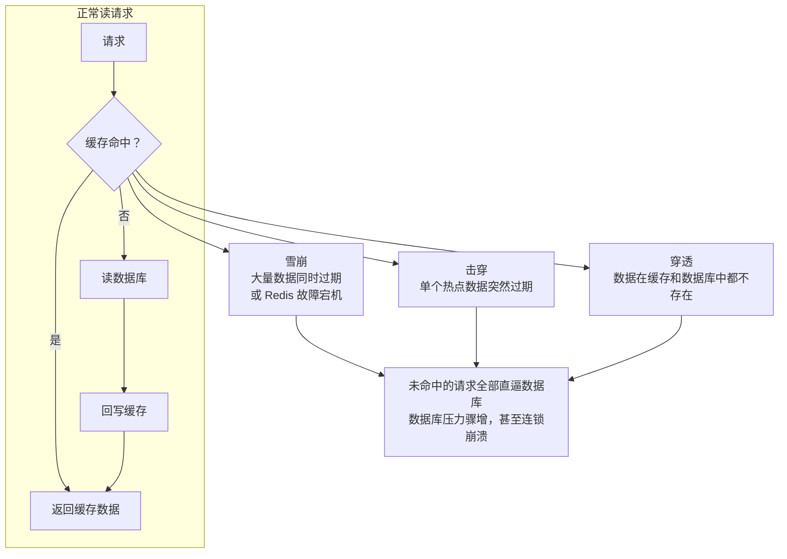
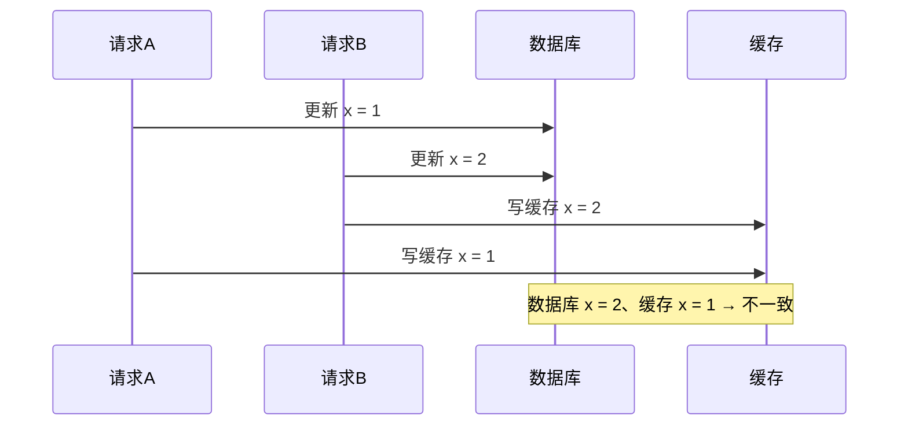
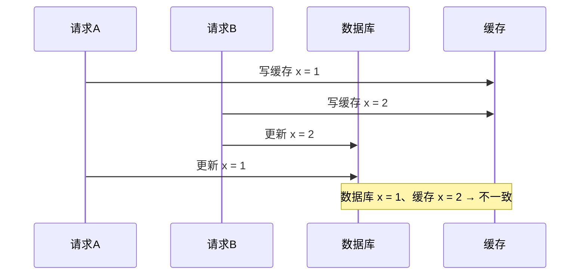
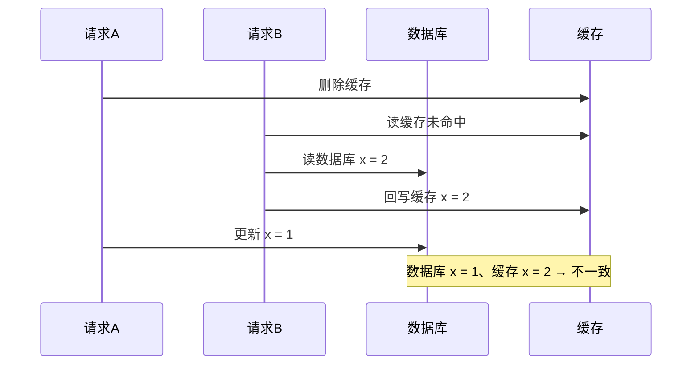
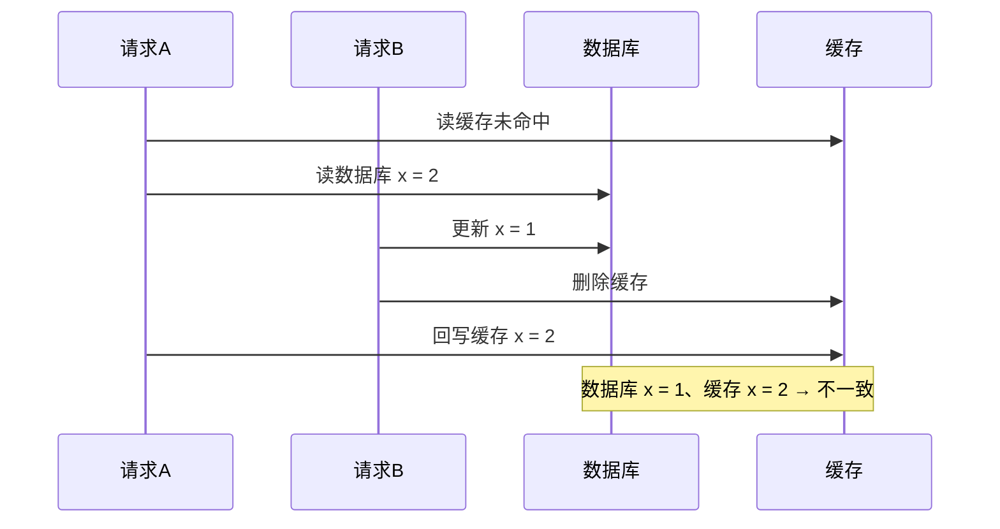

# 缓存

本章的主线是「用缓存换性能」的代价：先用三种典型故障说明缓存失效如何把压力反噬到数据库，再讨论缓存与数据库双写时的一致性，最后落到工程上更可行的 Cache Aside 策略与异步删除的改进方案。

+ **三种故障**：雪崩是「大量数据同时过期或 Redis 故障宕机」，击穿是「单个热点数据突然过期」，穿透是「数据在缓存和数据库中都不存在」。前两者靠过期时间加随机、互斥锁、后台更新、限流熔断与高可靠集群来扛；穿透靠非法请求限制、缓存空值和布隆过滤器。
+ **一致性**：只要在写侧**双写**（更新缓存），无论谁先谁后都会不一致，因此写侧改为**删除缓存**；「更新数据库 → 删除缓存」再配合过期时间即可达到最终一致性。
+ **进一步改进**：删除缓存本身也可能失败，可用消息队列或订阅 MySQL binlog 做**异步重试**兜底；至于「为什么删而不是更新」，是因为数据常来自多表聚合，改一个字段牵动的表太多，而且并非所有数据都一直被访问。

## 雪崩、击穿、穿透

由于数据库比较慢，因此常用向redis这样的内存数据库做缓存。
但缓存异常会带来三个问题：
+ 缓存雪崩
+ 缓存击穿
+ 缓存穿透

### 雪崩
大量数据在同一段时间内过期或者Redis故障宕机时，此时若有大量用户请求无法在缓存中处理，那么请求会直通数据库导致数据库压力暴增甚至崩溃。
从而造成一系列的**连锁反应**，造成系统崩溃。

同一时间过期避免方案：
+ 避免过期时间相同（添加一定的随机性）
+ 互斥锁（但又带来了锁问题）
+ 取消过期时间，后台定期更新缓存，当然还是会有数据在内存紧张时被淘汰，有两种具体点的方案
    + 后台固定时间检测缓存有效性
    + 业务线程发现缓存失效后通知后台更新

Redis故障宕机应对方案：
+ 服务熔断或请求限流机制
+ 构建 Redis 缓存高可靠集群

### 击穿

通常业务中会有数据被频繁读取，这种被称为**热点数据**。
若热点数据突然过期了，此时大量的请求会**直接访问**数据库，数据库被冲垮。

应对方案：
+ 互斥锁：保证同一时间只有一个业务线程更新缓存，未能获取互斥锁的请求，要么等待锁释放后重新读取缓存，要么就返回空值或者默认值
+ 不给热点数据设置过期时间或者要过期前让后台进程更新缓存及过期时间

### 穿透
还有一种数据，**既不在缓存也不在数据库**。如果短时间内有大量的此类请求，这会让数据库的压力骤增。

发生情况：
+ 业务误操作，缓存中的数据和数据库中的数据都被误删除了，所以导致缓存和数据库中都没有数据
+ 黑客恶意攻击，故意大量访问某些读取不存在数据的业务

常见解决方案：
+ 非法请求限制
+ 缓存空值或默认值
+ 布隆过滤器快速判断数据是否存在

布隆过滤器标记流程：
1. 使用 N 个哈希函数分别对数据做哈希计算，得到 N 个哈希值
2. 将第一步得到的 N 个哈希值对位图数组的长度取模，得到每个哈希值在位图数组的对应位置
3. 将每个哈希值在位图数组的对应位置的值设置为 1

由于存在哈希冲突，那么查询结果会是
+ 过滤器说有，那么可能有
+ 过滤器说无，那么真的没有

## 数据库与缓存的一致性

先来考虑尽可能保证缓存与数据库一致的情况下的最优方案。
由于有两个对象，因此明显有：
+ 更新数据库->更新缓存
+ 更新缓存->更新数据库

**更新数据库->更新缓存**

1. 请求A将数据库里x更新为1
2. 请求B将数据库里x更新为2
3. 请求B更新缓存x=2
4. 请求A更新缓存x=1

此时缓存与数据库不一致。

**更新缓存->更新数据库**

1. 请求A更新缓存x=1
2. 请求B更新缓存x=2
3. 请求B将数据库里x更新为2
4. 请求A将数据库里x更新为1

此时缓存与数据库不一致。

无论先更新哪个都会在**双写情况下**出现不一致。

### Cache Aside策略

分为读策略和写策略：
+ 写策略
    + 删除缓存
+ 读策略
    + 缓存未命中
    + 读数据库
    + 回写缓存

那么又有两种方案：
+ 删除缓存->更新数据库
+ 更新数据库->删除缓存

**删除缓存->更新数据库**

1. 请求A，删除缓存
2. 请求B，缓存未命中
3. 请求B，读数据库x=2
4. 请求B，更新缓存
5. 请求A，更新数据库x=1

**更新数据库->删除缓存**

1. 请求A，缓存未命中
2. 请求A，读数据库x=2
3. 请求B，更新数据库x=1
4. 请求B，删除缓存
5. 请求A，更新缓存

无论哪个先都会出现**读+写**并发时的不一致，但是在实际中，更新数据库->删除缓存产生的一致性发生概率低（因为缓存的写入远快于数据库的写入）。

再配合上给缓存数据添加过期时间，也能达到最终一致性。
除了过期时间，分布式锁也行，不过会对写入性能带来不少影响。

不过其实还有问题，那就是删除缓存时失败，还是会导致不一致。

### 进一步的改进

消息队列或者订阅MySQL binlog

**消息队列**：
将操作放入消息队列，失败了后，利用消息队列进行重试。

**订阅MySQL binlog**：
通过一个中间件从binlog日志中获取信息（模拟MySql的主从协议）+消息队列+重试删除

这两种方法有一个共同的特点，都是采用**异步操作缓存**。

### 为什么是删除缓存

实际中，数据可能来自多表聚合查询。
更新一个字段，数据库可能会更新大量的表。
同时所有的数据并不是一直在访问。

