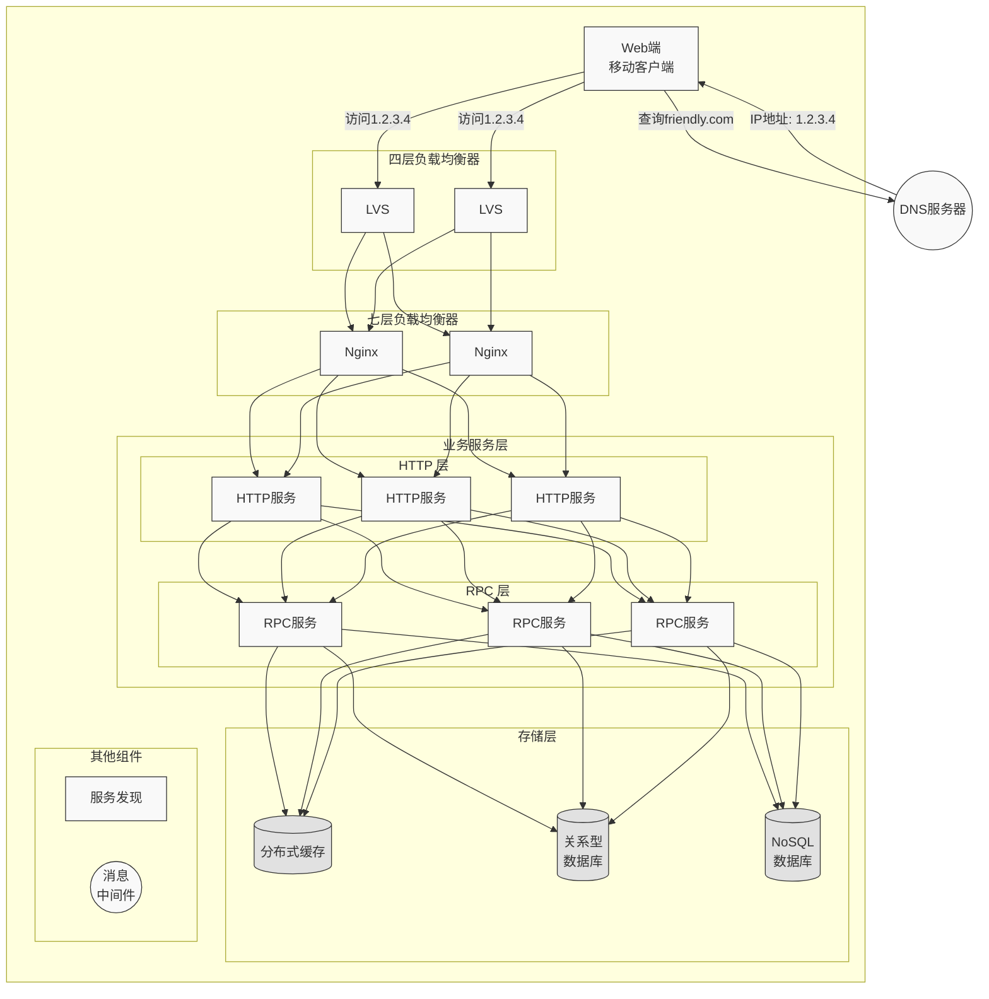
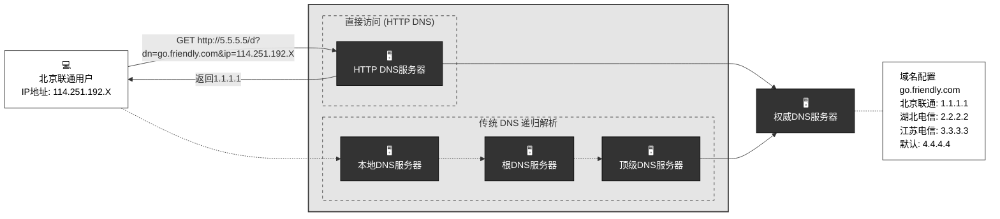
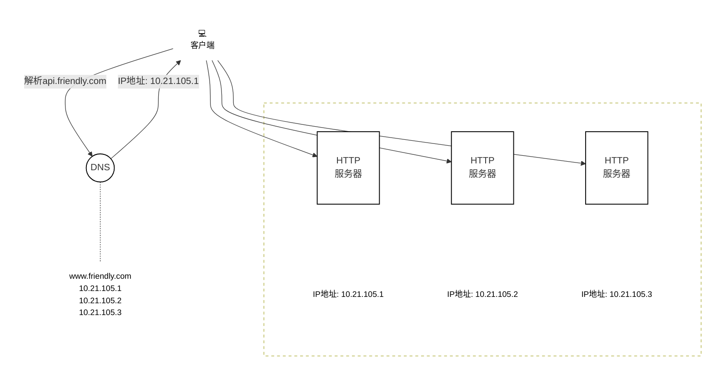
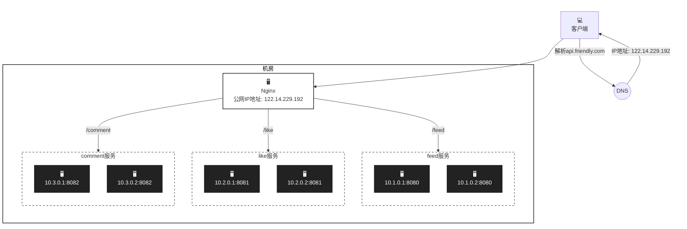
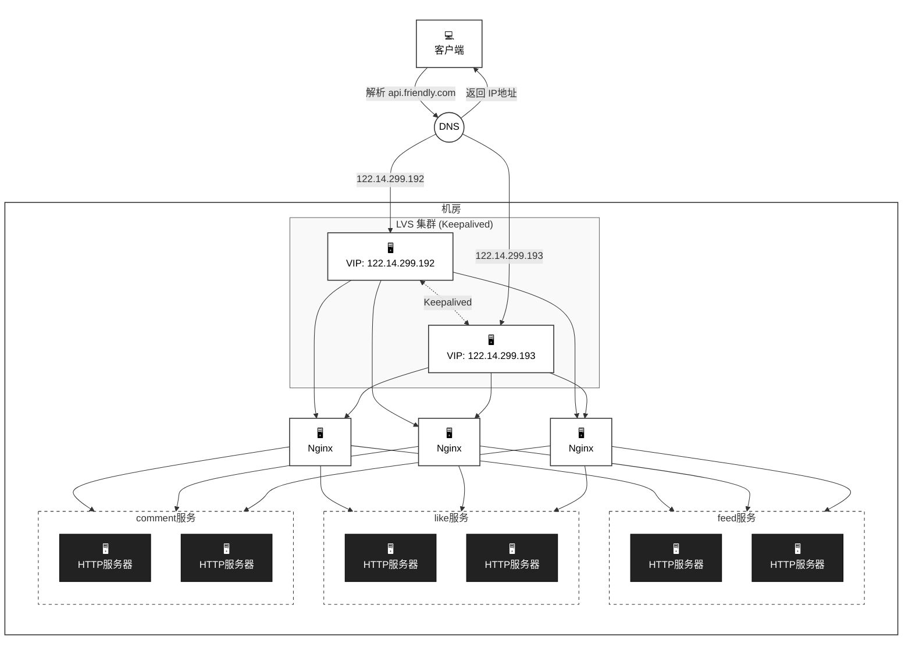
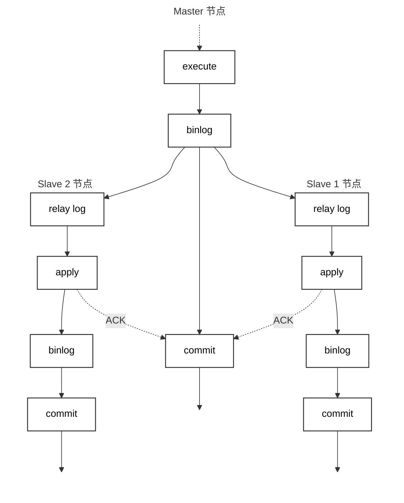
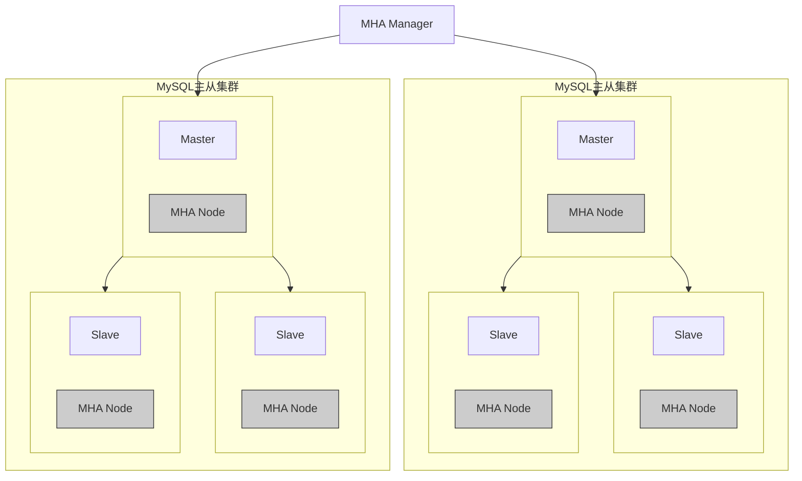

# 公司架构

## 单机房架构

多机房额外的要求：
+ 海量用户
+ 有充足的工程师，且有多机房的工程师
+ 现金流通畅

假设单机房架构服务于一个互联网社交应用，并提供Web端和移动客服端两种使用途径，各角色如下：
+ DNS 服务器负责将用户访问 Friendly 的域名映射为公网 IP 地址（或称为整个机房的入口 IP 地址），然后用户请求就可以通过 IP 协议进入机房了。
+ LVS 提供对外的公网 IP 地址作为机房的入口，同时作为四层负载均衡器将用户请求分发到 Nginx 集群。
+ Nginx 作为七层负载均衡器，根据 HTTP(S)请求的协议头或 URL 路径规则将用户请求转发到对应的业务 HTTP 服务器。
+ 业务服务层的 HTTP 服务真正处理用户请求，根据不同的 HTTP URL 向 RPC 服务发送业务逻辑处理请求。
+ 业务服务层的 RPC 服务执行核心业务逻辑。如果业务逻辑涉及读/写数据，那么它会进一步访问数据层；如果业务逻辑涉及与其他 RPC 服务的交互，那么它也会调用其他 RPC 服务。
+ 存储层是所有存储系统的集合，包括分布式缓存、关系型数据库、NoSQL 数据库等。分布式缓存提供数据缓存，用于应对高并发的读请求访问；关系型数据库作为持久化存储保存用户数据（需要注意的是，若无特殊说明，本书后续章节提及的数据库均为关系型数据库），常见的关系型数据库包括 MySQL、SQLite、SQL Server 等；NoSQL 数据库是一个大类，被应用于关系型数据库无法发挥作用的场景。
+ 服务发现负责保存每个服务的动态访问地址列表，以便其他服务可以快速查找到某服务的访问地址。其功能与 DNS 相似。
+ 消息中间件作为常用的研发中间件，用于请求异步执行、服务间解耦、请求削峰填谷。

## 客服端链接技术：DNS

DNS应用好处：
+ 互联网公司可以创建简单、便于用户记忆的域名并注册到 DNS 服务器，用户仅需输入域名就能访问到对应的网站。
+ 通过维护域名与多个 IP 地址的映射关系，DNS 可以将针对同一个域名的不同用户请求解析到不同的 IP 地址，从而缓解单一后台服务器的资源压力。
+ 互联网公司因架构升级、网络改造等需要变更机房公网 IP 地址时，仅需在 DNS 服务器中重新配置最新的 IP 地址，而不会对用户造成任何干扰。
+ 基于 DNS 可以实现灵活的负载均衡策略，比如 DNS 服务器可以对 IP 地址进行监测——如果发现机房某公网 IP 地址对应的服务器宕机，那么 DNS 服务器可以将这个 IP 地址及时摘除，防止用户无法访问后台。

[DNS技术基本原理](../网络/网络层.md#dns)

## 客户端链接技术：HTTP DNS

DNS的问题：
+ 域名解析需要进行递归查询，这势必会带来更高的访问延迟。
    + 在实际应用中常常有1s以上的情况出现
+ 本地域名服务器是分地区、分运营商的，不同运营商实现的DNS解析策略不同。
    + 由于权威域名服务器获取的是本地域名服务器的IP地址，而非客户端的IP地址，所以在定位客户端地理位置时不一定准确，最终域名解析得到的IP地址对于客户端而言可能不是距离最近、最优的访问节点。
    + 更有甚者，某些运营商为了节约资源，会直接将域名解析请求转发到其他运营商的本地域名服务器（即“域名转发”），这样做的后果就是用户得到了与其网络运营商不相符的IP地址，用户访问网络请求变慢。
+ DNS劫持问题
    + 很多知名的互联网公司备受DNS劫持的困扰，运营商可能基于本地域名服务器做DNS劫持，黑客可能篡改计算机Hosts文件做DNS劫持

HTTP DNS 的原理：
+ 客户端指定HTTP DNS服务器的IP地址（如5.5.5.5 ），使用HTTP调用域名解析接口/d,并传入待解析的域名和客户端的IP地址。
+ HTTP DNS服务器负责向权威DNS服务器发起域名解析请求，并将最优IP地址返回
+ 客户端获取到域名IP地址后，直接向此IP地址发送业务协议请求。

> HTTP DNS服务器不通过域名提供服务
>
> HTTP DNS服务提供商会采用如BGP （边界网关协议）等手段让这个IP地址在全国各地都做到就近访问。
>
> 以腾讯云HTTP DNS产品为例，它接入了 BGP Anycast 网络架构，与全国最主要的17个运营商建立了 BGP互联，确保各个运营商的用户都能快速访问到HTTP DNS服务器；
> 同时，腾讯云在多个数据中心部署了多个HTTP DNS服务节点，任意节点发生故障均可无缝切换到备用节点，保证了 HTTP DNS服务的高可用。

HTTP DNS的好处：
+ 降低域名解析延迟：通过直接访问HTTP DNS服务器，缩短了域名解析链路，不再需要递归查询。
+ 防止域名劫持：将域名解析请求直接通过IP地址发送至HTTP DNS服务器，绕过运营商本地DNS服务器，避免了域名劫持问题
+ 调度精准性更高：HTTP DNS服务器获取的是真实客户端的IP地址，而不是本地DNS服务器的IP地址，即能够基于精确的客户端位置、运营商信息，将域名解析到更精准的、距离更近的IP地址，让客户端就近接入后台服务节点。
+ 快速生效：当与域名关联的IP地址发生变更时，HTTP DNS服务不受传统DNS技术多级缓存的影响，域名更新能够更快地覆盖到全量客户端。

虽然HTTP DNS有诸多优势，但是我们并不能认为它可以完全取代DNS。
应该设计足够强大的容灾策略，尽力保证域名解析的可用性。
1. 客户端使用HTTP DNS尝试解析域名
2. 上一步失败，降级到使用DNS技术
3. 上一步失败，直接接使用预留的域名兜底IP地址作为域名解析结果

应用时还可以使用如下策略：
+ 安全策略：HTTP DNS是基于标准的HTTP的，为了保证数据安全，可以更进一步使用HTTPS
+ IP地址选取策略：HTTP DNS服务可以将最优IP地址按照顺序多个下发，客户端默认选取第一个IP地址优先校验连通性，如果连通性不佳，则再选取下一个IP地址。
+ 批量拉取策略：在客户端应用**冷启动或网络切换**（如将Wi-Fi切换到蜂窝网络） 时，客户端自动批量拉取域名和IP地址列表的映射数据并缓存，以便在后续请求中使用，预期提升精准调度能力和域名解析性能。

## 接入层的演进

早期架构如图所示

问题：
+ 可用性低：如果某个业务服务实例宕机，那么DNS服务器将无法高效地感知到其IP地址已不可用，导致被DNS解析到此IP地址的用户请求均不可用。
+ 可扩展性差：
    + 当业务服务需要扩容时，总需要额外配置DNS；
    + 而且受限于DNS解析的生效周期，扩容后的服务新地址难以实时生效。
+ 安全风险高：业务服务的IP地址都是公网IP地址，这相当于后台的所有网络地址都暴露在公网环境中，存在网络安全隐患。

### Nginx

Nginx是一种自由的、开源的、高性能的HTTP服务器和反向代理服务器，同时也是IMAP, POP3、SMTP的代理服务器。
Nginx既可以作为HTTP服务器进行网站的发布处理，也可以作为反向代理实现负载均衡功能。

+ 正向代理：代理客户端访问
+ 反向代理：代理服务器服务

HTTP位于OSI七层模型的第七层（应用层），所以Nginx作为反向代理也常被称为“七层负载均衡器”。

Nginx服务器需要将每个业务服务的网络地址设置在nginx.conf配置文件中，才能实现与业务服务的通信。

但是业务服务会频繁地迭代与扩容，这意味着Nginx upstream服务池中的服务器实例地址列表会频繁地变更。
需要运用：
+ ngx lua:这个模块将Lua语言嵌入Nginx，从而允许开发人员编与Lua脚本并部署到Nginx中执行。
+ ngx_http_dyups_module:这个模块使得Nginx不用重新启动就能热更新upstream配置并生效。

流程如下：
+ 每隔一段时间(如3s)就从服务注册中心获取一次nginx.conf配置文件中所有upstream配置的服务地址列表。
+ 获取服务地址列表成功，生成最新的upstream配置，通过ngx_http_dyups_module模块将其更新到Nginx工作进程中。

Nginx进行反向代理的优势
+ DNS服务器指向Nginx服务器，业务服务器网络地址切换无须配置DNS。
+ 在用户请求和业务服务器之间实现了负载均衡，更便于控制业务服务流量调度。
+ 对外只暴露一个公网IP地址，节约了有限的IP资源。Nginx服务器与业务服务器之间通过内网通信。
+ 对业务服务器起到了保护作用，外网看不到业务服务器，只能看到不涉及业务逻辑的Nginx反向代理服务器。
+ 增强了系统的可扩展性，业务服务器扩容能做到准实时生效。
+ 提高了业务服务器的可用性。任何一个业务服务实例挂掉，Nginx服务器都可以将用户请求迁移到其他服务实例。

### LVS 

LVS （ Linux Virtual Server, Linux虚拟服务器）是一个虚拟的服务器集群系统，从Linux 2.6版本开始它已经成为Linux内核的一部分，即LVS运行于操作系统层面。

LVS和Nginx的区别：
+ Nginx是基于OSI参考模型的第七层（应用层）协议开发的，采用了异步转发形式。
    + Nginx在保持客户端连接的同时新建一个与业务服务器的连接，等待业务服务器返回响应数据，然后再将响应数据返回给客户端。
    + Nginx选择异步转发的好处是可以进行失败转移（failover）
    + 如果与某台业务服务器的连接发生故障，那么就可以换另一个连接，提高了服务的稳定性。
    + Nginx主要强调的是“代理”。
+ LVS是基于OSI参考模型的第四层（网络层）协议开发的，采用了同步转发形式。
    + 当LVS监听到有客户端请求到来时，会直接通过修改数据包的地址信息将流量转发到下游服务器，让下游服务器与客户端直接连接。
    + LVS主要强调的是“转发”。

表 1-2

| 转发模式 | 优 势 | 劣 势 |
| :--- | :--- | :--- |
| NAT | RS 无须配置 VIP | DS 需要作为网关 性能一般 |
| FULLNAT | RS 无须配置 VIP 对网络环境要求较低 | 丢失客户端 IP 地址 性能一般 |
| TUN | 性能好 | 服务器需要支持 IP 隧道协议 RS 需要配置 VIP |
| DR | 性能好 | DS 和 RS 需要在同一个物理网络中 RS 需要配置 VIP |

 

+ 如果我们希望 LVS 有更强的网络环境适应性，则可以选择 FULLNAT 模式（这也是书本作者推荐的模式）
+ 而如果希望 LVS 有更高的性能，则可以选择 DR 模式。

### LVS和Nginx的混合

+ LVS的性能更高，便于Nginx构建集群，LVS作为Nginx集群的四层负载均衡器，可以有效提高Nginx的可扩展性
+ Nginx的功能更为强大，用它作为业务HTTP服务器的七层负载均衡器，能将不同的HTTP URL调度到不同的业务服务并提高业务服务的高可用性和可扩展性。

将机房配置的LVS的公网IP地址（即VIP ）作为域名，客户端请求经过DNS解析后进入LVS，
然后LVS使用如FULLNAT模式将客户端请求转发到任意一台Nginx服务器，
Nginx服务器再根据HTTP URL将客户端请求转发到某个upstream服务池的任意一个服务器实例上。

此架构有一个明显的缺点，即LVS是单点：如果LVS宕机，则整个机房将无法对外提供服务。
通常，我们可以采用主从热备方案来解决单点的高可用问题。
业界常见的实现主从热备的技术方案是Keepalived+VIP

LVS虽然性能极高，但也是有上限的。
假设我们的互联网产品已经拥有亿级用户，那么单台LVS就会遇到性能瓶颈。
我们可以使用多台LVS对外提供服务。如果有N台LVS对外提供服务，那么就要配置N个VIP，
这些VIP都绑定了同一个域名，客户端依赖DNS轮询来决定访问哪台LVS。

绝大多数互联网应用来说，做到这一步已经可以解决机房接入层的高可用、高性能、可扩展的问题了。
最终机房接入层架构已经趋于完备，此时：
+ 通过DNS轮询方式扩展LVS的性能
+ 通过 Keepalived 保证 LVS
+ 通过LVS扩展Nginx的性能
+ 将Nginx作为业务HTTP服务器的七层负载均衡器，提高了业务服务的高可用性与可扩展性。

## 服务发现

任何服务都涉及与其他服务通信的问题。

要求每个服务的研发人员主动维护下游服务地址是不现实的，我们需要为每个服务提供可以自动发现下游服务地址列表的能力，这就是服务发现。
服务发现组件是微服务架构下最重要的基础组件之一

服务发现的技术原理并不复杂，一般通过提供一个服务注册中心来实现。
这个服务注册中心主要负责两件事情：管理每个服务的地址列表(注册)和将某服务的地址告知调用者(发现)。

服务发现过程：
1. 服务B的各个服务实例启动后，将自己的地址信息注册到服务注册中心，由服务注册中心将其存储起来。
2. 调用者A向服务注册中心查询服务B的地址。
3. 服务注册中心将其存储的服务B已注册的实例地址列表返回给调用者A
4. 调用者A得到地址列表，可向服务B的任意一个实例地址发起远程调用

调用者A除了可以主动查询服务地址，还可以采取订阅推送的方式与服务注册中心通信：
+ 调用者A在进程启动时就与服务注册中心通信，订阅关于服务B的地址数据
+ 如果服务注册中心有服务B的地址数据，或者服务B的地址发生了变更，那么它会主动将最新地址列表推送给调用者A

正常情况下，服务自行处理注册与注销，但是异常情况下，没有注销，因此，服务注册中心应该有对已注册的服务地址的探活能力：
+ 第一种思路是主动探活：服务注册中心周期性地向每个已注册的服务地址发起探测请 求
    + 只适用于小规模
+ 第二种思路是心跳探活：服务注册中心为每个已注册的服务地址记录一个最近心跳时间，服务实例启动后，每隔一段时间（如30s）就向服务注册中心发送一个心跳包，服务注册中心收到心跳包后更新对应服务地址的最近心跳时间。
    + 注册中心因自身bug或者网络分区等导致导致**过度地址摘除**，会产生一些坏结果。一般监测摘除数量来报警。

当服务的地址列表发生变更时，为了让调用者尽快感知到这件事情，服务注册中心需要主动推送最新地址列表给调用者。
但这会导致**推送风暴**。解决方案如下：
+ 建议推送的数据是“新增了哪些地址” “哪些地址已废弃”的**增量数据形式**，而不是全量地址列表，这能在一定程度上节约推送数据的网络带宽
+ 服务注册中心本身也是一个服务，如果公司的服务注册中心有条件部署**大量的实例**，那么推送风暴问题也就被轻易解决了，毕竟分摊到每个服务注册中心实例的推送的节点不会很多。
+ 可以采用推拉结合的方式：服务注册中心**最多给N个调用者**节点推送地址变更信息，其他节点周期性地（如Imin）从服务注册中心拉取最新地址列表

由于服务发现组件的存在，调用者只需要关心要调用谁，而不需要关心被调用者的地址。
调用者可以随时升级、扩容，不用担心调用者找不到。

作为微服务架构下最核心的组件之一，服务发现真正为微服务带来了弹性
## RPC服务

由于RPC通信流程相对固定，gRPC、Thrift等RPC框架都可以利用所约定的协议定义文件生成脚手架代码，使用者只需要将具体的方法处理代码完成后就能实现RPC通信了。

RPC只是一种用于屏蔽远程过程调用的设计，它与HTTP不是对立的，因为两者不是一个层面的概念。

RPC底层的网络通信可以使用TCP实现（如Thrift）,也可以使用HTTP实现（如gRPC ）,其本身并无限制。

一般对外使用HTTP，对内使用RPC。

## 存储层技术：MySQL

关系型数据库的理论知识、技术产品已经发展到非常成熟的地步，所以RDB是目前应用最广泛的数据库系统。

关系型数据库以行和列的形式存储数据，行表示一个实体记录或者实体之间的关系记录，列表示记录的属性。
这一系列的行和列被称为数据表，一组数据表组成了关系型数据库。
关系型数据库使用结构化查询语言(Structured Query Language, SQL)来定义数据以及操作数据。

> MySQL并不符合SQL标准

### 高可用架构1：主从模式

是主从模式：一台MySQL服务器作为Master（主节点）, 若干MySQL服务器作为Slave （从节点）
+ 在正常情况下，只有Master处理写数据请求，同时Master与Slave通过主从复制技术保持数据一致。
+ 当Master发生故障宕机时，某个Slave会被提升为Master继续对外提供服务，这样可以实现MySQL的高可用。

Slave在Master宕机时能够代替它的前提条件是，Slave与Master的数据一致。
所以, 主从模式具备高可用性的基础是主从复制技术。

[MySQL主从复制的实现原理](../mysql/日志篇.md#主从复制)

Master提交事务不需要经过Slave的确认，也不管Slave是否已接收binlog,Slave写relay log失败、重新执行SQL语句失败等异常情况并不会被Master感知,
所以MySQL主从复制是异步的，Master提交完事务就直接返回了。

异步方式的主从复制有一个潜在隐患：如果Master在提交事务成功后，但尚未发送binlog给Slave时就出现异常宕机了，
那么对MySQL执行主从切换就会造成事务数据的丢失，因为被提升为新Master的Slave并未复制这个事务。
为了解决数据丢失的问题，MySQL 5.5版本提供了半同步复制模式

> 在半同步复制模式下，Slave向Master发送ACK响应的时机并不是重新执行SQL语句后，而是事务数据被写入relay log后。

半同步复制可以提高主从数据的一致性，但是Master提交事务要等待Slave的确认，所以写性能会受到一定的影响。

Master会因为向过多的Slave复制数据而压力倍增，这个问题被称为“复制风暴”。
实际中，存在从向从复制的情况。

### 高可用架构2：MHA

在主从模式基础上，就应该考虑如何检测节点故障和执行自动主从切换

MHA由两部分组成：MHA Manager (管理节点)和MHANode (数据节点)
+ MHA Manager： MHA的“决策层”，负责自动检测Master的故障，检查主从复制状态，执行自动主从切换等。
    + MHA Manager可以管理多个MySQL主从集群，通常被部署在单独的服务器上。
+ MHA Node：被部署在每台MySQL服务器上，主要负责修复主从数据的差异。

MHA故障转移工作流程：
1. MHA Manager周期性地探测Master心跳，如果连续4次探测不到心跳，则认为Master 宕机。
2. MHA Manager 判断各个 Slave 的 binlog,哪个 Slave 的 binlog 数据更接近 Master 数据，就将哪个Slave作为备选Master
3. MHA Node试图通过SSH访问Master所在的服务器：
    + 如果网络可达，那么MHA Node可以获取到Master的binlog数据。MHA Node对比Slave与Master的binlog数据，如果发现Slave数据与Master的binlog数据有差异，则会将差异数据主动复制到Slave,以保持主从数据一致。
    + 如果网络不可达，那么MHA Node对比各个Slave的relay log差异，并做差异数据补齐。
4. MHA Manager构建新主从关系，将备选Master提升为Master,其他Slave向新的Master复制数据。

如果将MHA和半同步复制模式一起使用，则可以更进一步大幅降低数据丢失的风险。

### 高可用架构3：MMM
一个 MySQL 双主故障切换和双主管理的脚本组件

架构如下
+ Master 1:真正的Master,负责处理写请求。
+ Master 2 (备用)：当Master 1宕机时，Master 2接替它作为新的Master处理写请求Master 2与Master 1相互复制数据，一般采用半同步复制模式。
+ Slave (若干):向Master 1复制数据，并且为了不影响Master 1的性能，采用异步复制模式。
+ mmm-monitor: monitor角色，与各mmm-agent通信以检测MySQL服务器的健康状况，并决策是否主从切换。
+ mmm-agent：被部署在每台MySQL服务器上，作为节点代理与monitor通信，一方面监控本机MySQL状态，另一方面执行monitor下发的指令。
+ write vip： MySQL对外提供写数据服务的虚拟IP地址，只与Master 1和Master 2其中一个节点绑定。
+ read vip： MySQL对外提供读数据服务的虚拟IP地址，主要与Slave绑定。

这套解决方案比较古老，不支持MySQL GTID,
目前MMM组件处于无人维护的状态

### 高可用架构4：MGR

MySQL 5.7.17 版本推出的高可用解决方案，它具备如下特性。
+ 一致性高：数据复制基于分布式共识算法Paxos,可以保证多个节点数据的一致性。
+ 容错性高：只要不是超过一半的节点宕机，就可以继续对外提供服务。
+ 灵活性强：MGR支持单主模式和多主模式。在单主模式下会自动选举Master,在多主模式下每个MySQL节点都可以同时处理写请求。

至少由3个MySQL节点组成一个复制组，一个事务必须经过复制组内超过一半的节点决议通过后才能提交。
至少有2个节点决议通过，这个事务才能够提交。

```mermaid
flowchart LR
    %% 定义节点
    Master[Master]
    Slave1[Slave 1]
    Slave2[Slave 2]
    
    Exec[execute]
    
    C1[certify]
    C2[certify]
    C3[certify]
    
    B1[binlog]
    Cm1[commit]
    
    R2[relay log]
    A2[apply]
    B2[binlog]
    Cm2[commit]
    
    R3[relay log]
    A3[apply]
    B3[binlog]
    Cm3[commit]

    %% 建立连线 (利用从左到右的数据流，Mermaid会自动对齐)
    Master --> Exec
    
    Slave1 --> C2
    Slave2 --> C3
    
    %% execute 向三个 certify 广播 (这里直接连线，自动布局会将其对齐)
    Exec --> C1
    Exec --> C2
    Exec --> C3
    
    %% 后续数据流
    C1 --> B1 --> Cm1 --> E1(( ))
    
    C2 --> R2 --> A2 --> B2 --> Cm2 --> E2(( ))
    
    C3 --> R3 --> A3 --> B3 --> Cm3 --> E3(( ))

    %% Consensus 虚线框
    subgraph Consensus ["Consensus"]
        C1
        C2
        C3
    end
    
    %% 隐藏最后的终点小圆圈，模拟悬空箭头
    style E1 fill:#333,stroke:none
    style E2 fill:#333,stroke:none
    style E3 fill:#333,stroke:none
    
    %% 虚线框样式
    style Consensus fill:none,stroke:#333,stroke-width:1px,stroke-dasharray: 5 5
```

如果在不同的MySQL节点上执行不同的写操作发生了事务冲突，那么先提交的事务先执行，后提交的事务被回滚。
在多主模式下，由于每个MySQL节点都可以执行写请求，在写请求高并发的场景下发生事务冲突的概率较大，会造成大量的事务回滚，所以官方更推荐单主模式。

> 这其实就告诉你，多主模式在写多的场景下就是滚木

在单主模式下，MGR会自动为复制组选择一个Master负责写请求。

如果复制组内超过一半的节点与Master通信失败，则认为Master宕机，MGR自动根据各节点的权重和ID标识重新选主，并很容易在各Slave之间达成共识。

由于MGR基于Paxos协议，所以主从节点数据有很强的一致性，可以做到数据不丢失。
此外，在一个拥有2N+1个节点的复制组中，MGR可以容忍N个节点发生故障，所以这套方案的容错性也很高。

数据强一致性的代价是每个写请求都涉及与复制组内大多数节点的通信。
MGR的写性能不及异步复制和半同步复制，MGR更适合要求数据强一致性，且写请求量不大的场景。

## 存储层技术：Redis

Redis具有如下特性：
+ 数据被存储在内存中，性能高。
+ 支持丰富的数据类型，包括字符串(String)、列表(List)、哈希表(Hash )、集合(Set)、有序集合(Ordered Set)等数据结构和相关数据操作。
+ 支持分布式，包括主从模式、哨兵模式、集群模式，理论上其可以无限扩展。
+ 基于单线程事件驱动模式实现，数据操作具有原子性。

> Redis的应用场景非常广泛，例如缓存系统、计数器、限流、排行榜、社交网络等

### 高可用架构1：主从模式

[具体流程](../redis/高可用性.md#主从复制是怎么实现的)

不论是MySQL主从复制，还是Redis主从复制，大部分存储系统的主从复制原理都基本类似，即Master向Slave发送全量数据和增量数据；
而且，如果Master向过多的Slave复制数据，则同样会出现“复制风暴”的问题。

### 高可用架构2：哨兵模式

哨兵模式的核心还是主从模式，只不过它在相对于主从模式下Master宕机导致不可写的情况下，提供了一种自动竞选机制：所有的Slave竞选新的Master

在Redis高可用架构中，Redis服务器除了可以是Master、Slave角色，还可以是Sentinel角色，它负责在Master宕机后自动选举出一个Slave升级为新的Master继续对外提供服务。

在一个主从模式的Redis架构中会部署若干Sentinel节点，每个Sentinel节点都会与MasterA Slave维持心跳。

### 高可用架构3：集群模式

实际上，互联网公司在应用Redis时，都会采用数据分片的方式：多个Master对外提供服务，全量数据分散在各个Master中。

Redis 3.0版本提供了集群(Redis Cluster)模式，使得Redis真正拥有了分布式存储能力。

整个Redis数据库被划分为16384个哈希槽，每个Master可以管理0〜16383个槽位(Slot),这些Master把16384个槽位都瓜分了。

当向Redis集群中写入某个数据时，会基于数据Key运行CRC16算法，然后将结果与16384取模得到一个槽位。

