# 网络系统

前端面对的是「一次请求对应一次响应」，后端面对的是「成千上万个连接同时在线」。本章关心的是：操作系统到底为网络提供了什么，以及高性能服务端是怎么用这些能力的。

+ **数据怎么少搬**：从 DMA 讲到零拷贝（`mmap`、`sendfile`、SG-DMA），目标始终是减少**用户态 / 内核态的切换**与**内存拷贝**次数；由此也带出 PageCache 与大文件的取舍。
+ **连接怎么多扛**：TCP Socket 天生一对一，于是有了多进程、多线程、线程池，最后收敛到 I/O 多路复用——`select` / `poll` / `epoll` 的演进，以及边缘触发与水平触发。
+ **代码怎么写**：把多路复用封装成面向对象的事件分发，就是 Reactor（同步、感知就绪）与 Proactor（异步、感知完成）两大模式，以及它们的 3 种 Reactor 变体。
+ **请求怎么分**：多机部署时用一致性哈希切分数据，再用虚拟节点把负载摊匀。

## 零拷贝

磁盘太慢了。

### 为什么要有DMA技术

DMA之前，I/O调用如下：
+ CPU 发出对应的指令给磁盘控制器，然后返回
+ 磁盘控制器收到指令后，于是就开始准备数据，会把数据放入到磁盘控制器的内部缓冲区中，然后产生一个**中断**
+ CPU 收到中断信号后，停下手头的工作，接着把磁盘控制器的缓冲区的数据一次一个字节地读进自己的寄存器，
    + 然后再把寄存器里的数据写入到内存，而在数据传输的期间 CPU 是**无法执行其他任务**的。

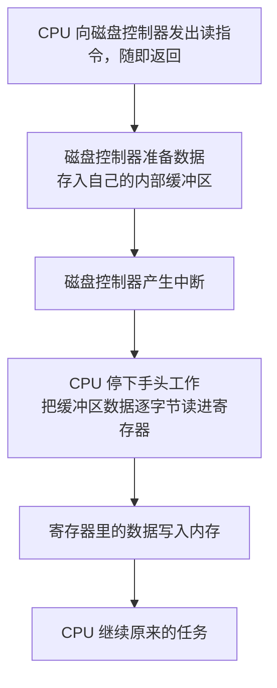

可以看到，这一路 CPU 都在亲自搬运数据（一次一个字节）。

但这样的方案只适合少量数据。
DMA技术专门释放CPU的时间，减少不必要的性能开销。

DMA过程：
+ 用户进程调用 read 方法，向操作系统发出 I/O 请求，请求读取数据到自己的内存缓冲区中，进程进入阻塞状态
+ 操作系统收到请求后，进一步将 I/O 请求发送 DMA，然后让 CPU 执行其他任务
+ DMA 进一步将 I/O 请求发送给磁盘
+ 磁盘收到 DMA 的 I/O 请求，把数据从磁盘读取到磁盘控制器的缓冲区中，当磁盘控制器的缓冲区被读满后，向 DMA 发起中断信号，告知自己缓冲区已满
+ **DMA 收到磁盘的信号**，将磁盘控制器缓冲区中的数据拷贝到内核缓冲区中，此时**不占用 CPU**，CPU 可以执行其他任务
+ 当 DMA 读取了足够多的数据，就会发送中断信号给 CPU
+ CPU 收到 DMA 的信号，知道数据已经准备好，于是将数据从内核拷贝到用户空间，系统调用返回

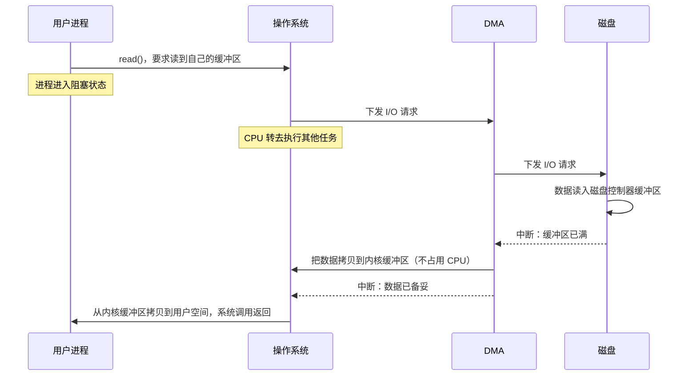

现在的I/O设备基本自带DMA

### 传统文件传输

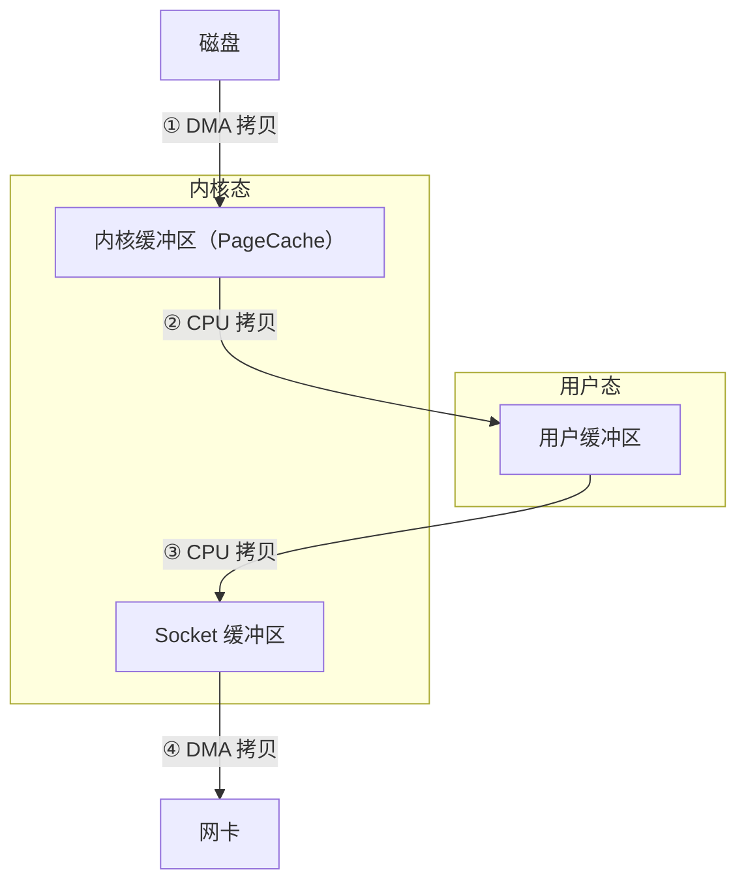

运行时，一共发生了4次内核态与用户态的切换，两次系统调用，一次为read()，另一次为write()。
还有4次数据copy，其中2次DMA，2次CPU。
+ 第一次：硬盘->内核
+ 第二次：内核->用户
+ 第三次：用户->内核socket
+ 第四次：内核socket->网卡

这种传统的模式，并发的潜在能力很差。
要想提高传输性能，就要减少**用户态与内核态的上下文切换**和**内存拷贝**的次数

### 零拷贝

两种方案：
+ mmap+write
+ sendfile

mmap将传统文件传输方案中的read换成mmap，让用户态共享从硬盘中读取出来的内核态数据，来减少一次copy。

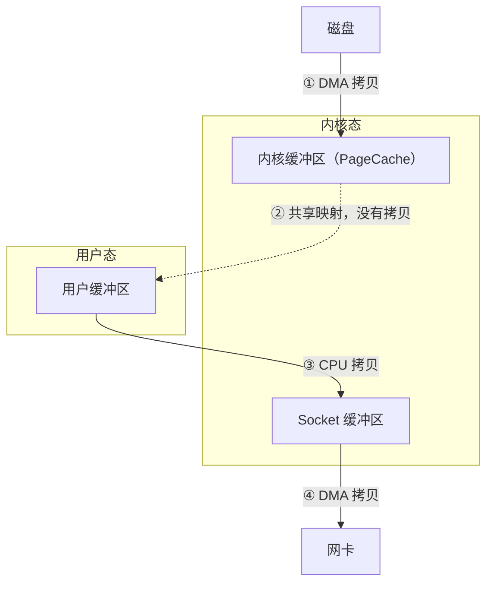

`mmap` 把 `read` 换成「把内核缓冲区映射到用户态」，用户态与内核态共享同一块 PageCache，于是少了一次「内核 → 用户」的 CPU 拷贝，但 `write` 那次「用户 → 内核 socket」的拷贝依然存在。

sendfile

在Linux内核2.1中，提供了一个sendfile()系统调用。
```C
#include <sys/socket.h>
ssize_t sendfile(int out_fd, int in_fd, off_t *offset, size_t count)
```

sendfile可以取代read和write系统调用，将系统调用减少到一次。
内核态从硬盘读取的数据会copy到内核的socket缓冲区，那么只有1次CPU copy。
这样就只会有 2 次上下文切换（进入内核态一次、返回用户态一次）。

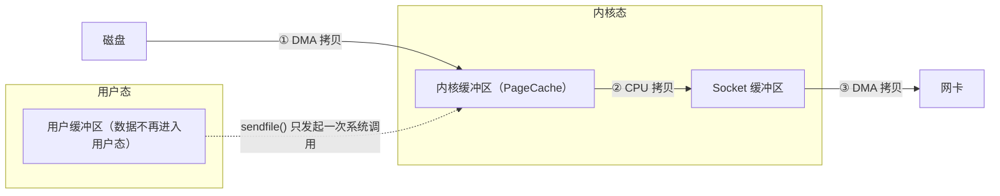

`sendfile` 取代了 `read` + `write`：数据全程留在内核态，用户缓冲区不再参与，于是只剩 1 次 CPU 拷贝、2 次上下文切换。

如果网卡支持SG-DMA技术，那么还会有所不同，此时内核态中的数据会被SG-DMA直接复制到网卡，跳过socket缓冲区。

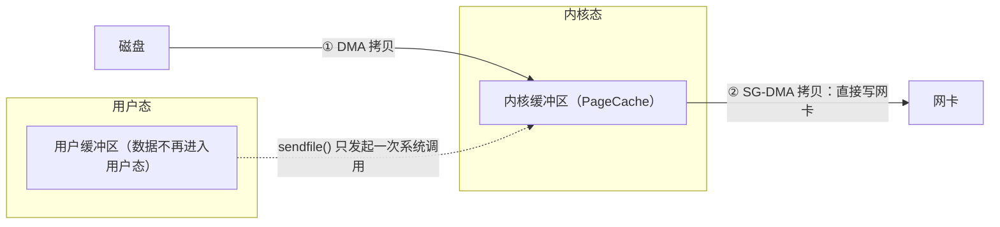

开启 SG-DMA 后，内核缓冲区不再把数据整体搬进 Socket 缓冲区，而只把「数据位置 + 长度」的描述符交给网卡，网卡按描述符直接从内存读——**Socket 缓冲区被跳过**。

零拷贝就是sendfile+SG-DMA。我们只有2次切换，2次数据拷贝，且不需要CPU来负责拷贝。
总体上来看，性能提升至少1倍以上。

### PageCache
前文所示的内核缓冲区其实就是磁盘高速缓存（PageCache）

PageCache的优点：（其实类似于CPU的cache）
+ 缓存最近被访问的数据
+ 预读功能

但是传输大文件(GB级)时，PageCache的性能会降低。
+ 挤占热点小文件
+ 对于大文件，PageCache并没有起到加速作用

大文件会影响PageCache的并发性能

### 大文件传输方式

此时不用PageCache，直接选择传统的读取方案就行，但是不可能让CPU干等。
因此读取时是直接I/O读取，CPU的程序是异步等待读取完（此时干别的事情）。

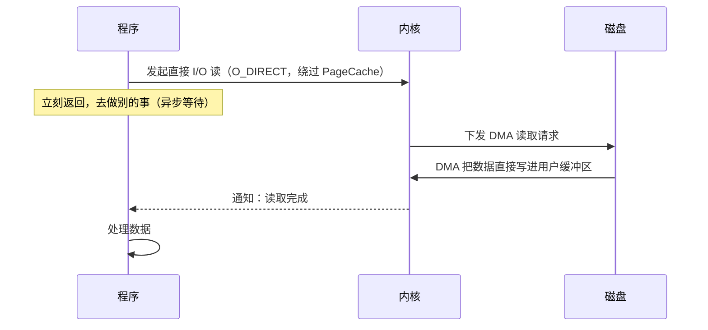

关键是「不等」：直接 I/O 跳过了 PageCache，也就没有了预读与缓存命中，必须靠异步的方式把等待时间利用起来。

用途：
+ 自行实现了磁盘数据缓存的程序，如MySQL
+ 大文件

## I/O多路复用：select/poll/epoll

### Socket模型

Socket编程，它是进程间通信里比较特别的方式，特别之处在于它是可以跨主机间通信。

创建 Socket 的时候，可以指定网络层使用的是 IPv4 还是 IPv6，传输层使用的是 TCP 还是 UDP。

接下来介绍基于TCP/IPv4的Socket编程。
+ 服务器端监听一个**IP地址和端口**
    + 绑定端口的目的：当内核收到 TCP 报文，通过 TCP 头里面的端口号，来找到我们的应用程序，然后把数据传递给我们。
    + 绑定 IP 地址的目的：一台机器是可以有多个网卡的，每个网卡都有对应的 IP 地址，当绑定一个网卡时，内核在收到该网卡上的包，才会发给我们
+ 客户端向服务器端绑定的 IP 和端口发送请求，进入 TCP 三次握手
    + TCP连接时会维护两个队列，TCP半连接队列和TCP全连接队列

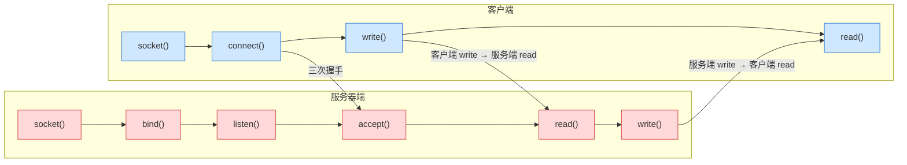

`connect()` 与 `accept()` 之间就是三次握手：内核会维护一个**半连接队列**（收到 SYN、还没完成握手）和一个**全连接队列**（已完成握手、等待 `accept()` 取走）。

基于 Linux 一切皆文件的理念，在内核中 Socket 也是以**文件**的形式存在的，也是有对应的文件描述符

### 如何服务更多的用户
TCP Socket只能一对一服务，还是同步阻塞，过于浪费资源。

单机理论最大连接数。

TCP 连接是由四元组唯一确认的：
+ 本机IP，本机端口
+ 对端IP，对端端口

因此最大客户端连接数为：客户端 IP 数 × 客户端端口数。
对于IPv4，则为 \\(2^{32} \times 2^{16}\\)。

但是还有更小的限制。
+ 在linux下，Socket是一个文件，一个进程能打开的文件是有限的（默认1024）
+ 内存。一个连接都会占用少量的内存。

### 多进程模型

最简单的方案是一个父进程与客户端建立了连接后，创建一个子进程（复制），然后由子进程完成剩下的事情。

子进程退出若处理不当，会产生僵尸进程。

这种方案应付100个客户端还行，但是上万不太行，且创建、切换进程是一个相对昂贵的操作。

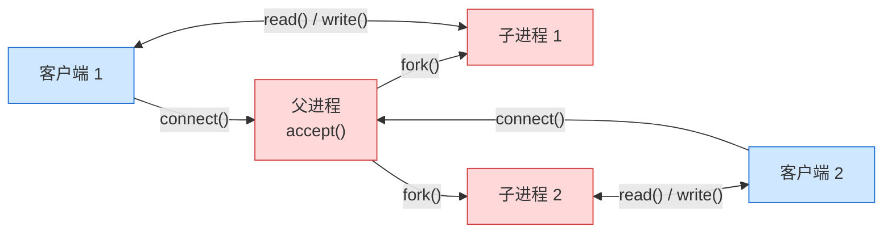

每个连接独占一个子进程：连接数一多，进程的创建与切换开销就压不住了。

### 多线程模型

进程的成本高，那么换用更为轻量级的线程来工作。

每次父进程连接完成后，将连接放入已连接**socket队列**。子线程负责获取连接进行工作。

频繁销毁创建线程还是有不少成本，因此采用**线程池**来解决。

由于队列是多个线程能获取，因此需要一个锁操作。

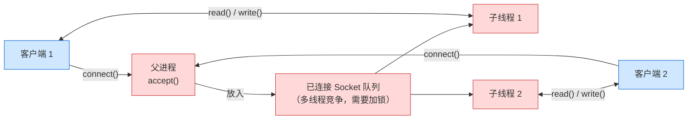

相比多进程模型：多了一个「已连接 Socket 队列」，并且由**子线程**（而不是子进程）从队列里取连接来服务。

### I/O多路复用

为每个请求分配一个进程或者线程或许不太合适，那么可以采用I/O多路复用来让一个进程维护多个socket。

一个进程虽然任一时刻只能处理一个请求，但是处理每个请求的事件时，耗时控制在 1 毫秒以内，这样 1 秒内就可以处理上千个请求，把时间拉长来看，多个请求复用了一个进程，这就是多路复用，这种思想很类似一个 CPU 并发多个进程，所以也叫做时分多路复用。

我们熟悉的 select/poll/epoll 内核提供给用户态的多路复用系统调用，**进程可以通过一个系统调用函数从内核中获取多个事件**。

这三种多路复用的性能有所差别。

### select/poll

select 实现多路复用的方式是：
+ 将已连接的 Socket 都放到一个**文件描述符集合**
+ 然后调用 select 函数将文件描述符集合**拷贝**到内核里
+ 让内核来检查是否有网络事件产生

检查的方式很粗暴，就是通过**遍历**文件描述符集合的方式，当检查到有事件产生后，将此 Socket 标记为可读或可写， 接着再把整个文件描述符集合**拷贝**回用户态里，然后用户态还需要再通过**遍历**的方法找到可读或可写的 Socket，然后再对其处理。

2次遍历，2次copy（有一次是用户态copy到内核态）

select使用固定长度的Bitsmap描述文件集合，受Linux的FD_SETSIZE限制，默认1024，只能监听0~1023的文件描述符

poll是改用动态数组，突破了select的1024上限，但仍然受「一个进程能打开的文件数」限制。

问题在于，select / poll 都用线性结构存储，且每次调用都要在用户态与内核态之间来回 copy。并发数一多，性能损耗会明显增大。

### epoll

epoll是解决C10K问题的利器。

先看 C 版的调用骨架：

```C
int s = socket(AF_INET, SOCK_STREAM, 0);
bind(s, ...);
listen(s, ...)

int epfd = epoll_create(...);
epoll_ctl(epfd, ...); //将所有需要监听的socket添加到epfd中

while(1) {
    int n = epoll_wait(...);
    for(接收到数据的socket){
        //处理
    }
}
```

Go 的 `syscall` 包几乎原样暴露了 Linux 的系统调用，所以 Go 版与 C 版是同一套流程，只是把括号换成了函数调用：

```go
package main

import (
	"fmt"
	"syscall"
)

// epoll 版回显服务器的骨架：与上面 C 版示例的调用一一对应。
func main() {
	// socket()：创建 IPv4 的 TCP socket
	listenFd, err := syscall.Socket(syscall.AF_INET, syscall.SOCK_STREAM, 0)
	if err != nil {
		panic(err)
	}
	// bind() + listen()：绑定 0.0.0.0:8080 并开始监听
	if err := syscall.Bind(listenFd, &syscall.SockaddrInet4{Port: 8080}); err != nil {
		panic(err)
	}
	if err := syscall.Listen(listenFd, 128); err != nil {
		panic(err)
	}

	// epoll_create：创建 epoll 对象（内核里是一棵红黑树 + 一条就绪链表）
	epfd, err := syscall.EpollCreate1(0)
	if err != nil {
		panic(err)
	}
	// epoll_ctl：把需要监听的 socket 加入 epfd
	if err := syscall.EpollCtl(epfd, syscall.EPOLL_CTL_ADD, listenFd, &syscall.EpollEvent{
		Events: syscall.EPOLLIN,
		Fd:     int32(listenFd),
	}); err != nil {
		panic(err)
	}

	// epoll_wait：从就绪链表中取出事件
	events := make([]syscall.EpollEvent, 128)
	for {
		n, err := syscall.EpollWait(epfd, events, -1)
		if err != nil {
			if err == syscall.EINTR { // 被信号打断，重试即可
				continue
			}
			panic(err)
		}
		for _, ev := range events[:n] {
			fd := int(ev.Fd)
			if fd == listenFd {
				// 新连接：accept() 之后同样要注册进 epfd
				connFd, _, err := syscall.Accept(listenFd)
				if err != nil {
					continue
				}
				_ = syscall.EpollCtl(epfd, syscall.EPOLL_CTL_ADD, connFd, &syscall.EpollEvent{
					Events: syscall.EPOLLIN,
					Fd:     int32(connFd),
				})
				continue
			}
			// 已连接的 socket 可读：read() 读出来再 write() 原样写回
			buf := make([]byte, 1024)
			rn, err := syscall.Read(fd, buf)
			if err != nil || rn == 0 { // 出错或对端关闭，摘掉监听并关闭
				_ = syscall.EpollCtl(epfd, syscall.EPOLL_CTL_DEL, fd, nil)
				_ = syscall.Close(fd)
				continue
			}
			fmt.Printf("fd %d 收到 %d 字节\n", fd, rn)
			_, _ = syscall.Write(fd, buf[:rn])
		}
	}
}
```

三段式调用正好对应下一段要画的三个动作：`EpollCreate1` 建对象（红黑树 + 就绪链表）、`EpollCtl` 增删待检测的 socket、`EpollWait` 取回就绪事件。不过现实中几乎不用手写这段代码——Go 运行时的 netpoll 已经用 epoll 实现了非阻塞 I/O，`net.Listen` 出来的 `Listener` 就跑在多路复用之上，这也是 Go 常被认为「天生适合写网络服务」的原因之一。

epoll通过两个方面解决了select/poll的问题。
+ 使用**红黑树**来跟踪进程所有待检测的文件描述字
+ 事件驱动机制。内核里维护了一个就绪**链表**

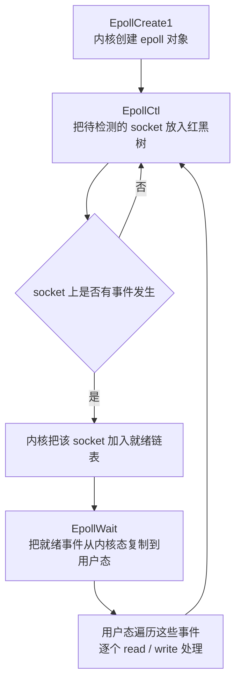

注意：epoll_wait是将内存从内核态复制到用户态，并不是共享。

epoll支持两种触发模式。

+ 使用边缘触发模式时，当被监控的 Socket 描述符上有可读事件发生时，服务器端只会从 epoll_wait 中**苏醒一次**，即使进程没有调用 read 函数从内核读取数据，也依然只苏醒一次，因此我们程序要保证一次性将内核缓冲区的数据读取完
+ 使用水平触发模式时，当被监控的 Socket 上有可读事件发生时，服务器端**不断地从 epoll_wait 中苏醒**，直到内核缓冲区数据被 read 函数读完才结束，目的是告诉我们有数据需要读取

边缘触发一般配合非阻塞I/O使用。
多路复用API返回的事件不一定可读写。
如果使用阻塞I/O。那么调用read/write时则会发生程序阻塞，因此最好搭配非阻塞I/O，以便应对极少数的特殊情况。


## 高性能网络模式：Reactor和Proactor
这是一种很常用的方案。

不过，无论是 Reactor，还是 Proactor，都是一种基于**事件分发**的网络编程模式，区别在于 Reactor 模式是基于**待完成**的 I/O 事件，而 Proactor 模式则是基于**已完成**的 I/O 事件。

### 演进

上一节解决的是「怎么等」：`select` / `poll` / `epoll` 让一个进程能同时盯住成千上万个 socket，谁就绪就处理谁。但这三种调用都是**面向过程**的——遍历事件、判断类型、再分派处理逻辑，全都得写在业务代码里；连接类型一多、业务一复杂，代码就散了。

Reactor模式其实是将面向过程的I/O多路复用进行了一个封装，变成了面向对象。
Reactor会对事件做出反应，然后根据事件类型分配（dispatcher）给某个进程/线程。

Reactor：
+ 监听和分发事件，包含连接、读写
+ 处理资源池负责处理事件，如read->业务逻辑->send

除了多Reactor单进程/线程比较垃圾外，剩下3种各有用途。

### 单Reactor单进程/线程

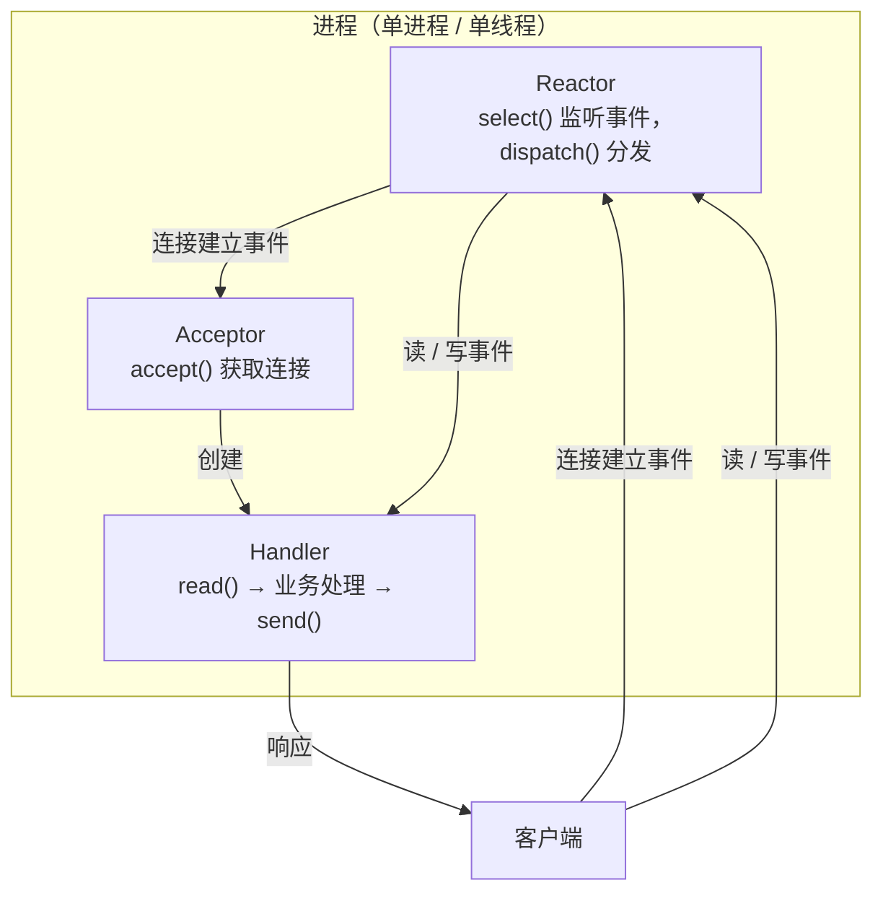

可以看到进程里有 Reactor、Acceptor、Handler 这三个对象：
+ Reactor 对象的作用是监听和分发事件
+ Acceptor 对象的作用是获取连接
+ Handler 对象的作用是处理业务

对象里的 select、accept、read、send 是系统调用函数，dispatch 和 **业务处理**是需要完成的操作，其中 dispatch 是分发事件操作。

方案流程：
+ Reactor 对象通过 select （IO 多路复用接口） 监听事件，收到事件后通过 dispatch 进行分发，具体分发给 Acceptor 对象还是 Handler 对象，还要看收到的事件类型
+ 如果是连接建立的事件，则交由 Acceptor 对象进行处理，Acceptor 对象会通过 accept 方法 获取连接，并创建一个 Handler 对象来处理后续的响应事件
+ 如果不是连接建立事件， 则交由当前连接对应的 Handler 对象来进行响应
+ Handler 对象通过 read ->业务处理 -> send 的流程来完成完整的业务流程

缺点：
+ 无法充分发挥多核性能
+ 若业务处理时间长，造成响应延迟

适用于业务处理很快的场景。

### 单Reactor多线程/进程

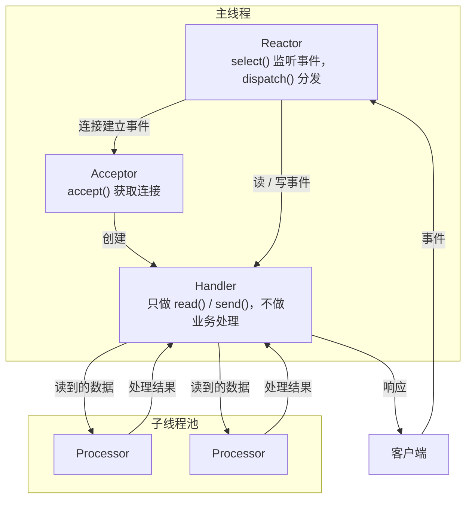

方案流程：
+ Reactor 对象通过 select （IO 多路复用接口） 监听事件，收到事件后通过 dispatch 进行分发，具体分发给 Acceptor 对象还是 Handler 对象，还要看收到的事件类型
+ 如果是连接建立的事件，则交由 Acceptor 对象进行处理，Acceptor 对象会通过 accept 方法 获取连接，并创建一个 Handler 对象来处理后续的响应事件
+ 如果不是连接建立事件， 则交由当前连接对应的 Handler 对象来进行响应
    + **Handler 对象不再负责业务处理**，只负责数据的接收和发送，Handler 对象通过 read 读取到数据后，会将数据发给子线程里的 Processor 对象进行业务处理
    + 子线程里的 Processor 对象就进行业务处理，处理完后，将结果发给主线程中的 Handler 对象，接着由 Handler 通过 send 方法将响应结果发送给 client

虽然能充分利用CPU的多核性能，但也带来了锁竞争问题，性能瓶颈在于Reactor。

### 多Reactor多进程/线程

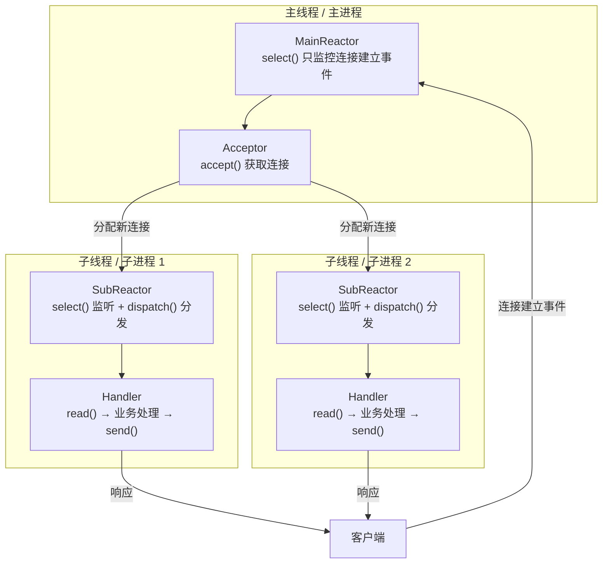

方案如下：
+ 主线程中的 MainReactor 对象通过 select 监控连接建立事件，收到事件后通过 Acceptor 对象中的 accept  获取连接，将新的连接分配给某个子线程
+ 子线程中的 SubReactor 对象将 MainReactor 对象分配的连接加入 select 继续进行监听，并创建一个 Handler 用于处理连接的响应事件
+ 如果有新的事件发生时，SubReactor 对象会调用当前连接对应的 Handler 对象来进行响应
+ Handler 对象通过 read -> 业务处理 -> send 的流程来完成完整的业务流程

此方案看起来复杂，实则更为简单
+ 主线程和子线程分工明确。主线程只负责接收新线程，子线程负责后续的业务处理
+ 主子线程交互简单，主线程只需把新连接交给子线程，子线程直接返回数据给客户端

Nginx就是此方案，只是有个细节不同。
它是没有MainReactor，而是分配到哪个子进程，就哪个子进程负责accept，然后放入自己的Reactor进行处理。

### Proactor

Reactor是非阻塞同步网络模式，而Proactor是异步网络模式。
+ Reactor 是非阻塞同步网络模式，**感知的是就绪可读写事件**。
    + 在每次感知到有事件发生（比如可读就绪事件）后，就需要应用进程主动调用 read 方法来完成数据的读取，也就是要应用进程主动将 socket 接收缓存中的数据读到应用进程内存中
    + 这个过程是同步的，读取完数据后应用进程才能处理数据
+ Proactor 是异步网络模式， **感知的是已完成的读写事件**。
    + 在发起异步读写请求时，需要传入数据缓冲区的地址（用来存放结果数据）等信息，这样系统内核才可以自动帮我们把数据的读写工作完成
    + 这里的读写工作全程由操作系统来做，并不需要像 Reactor 那样还需要应用进程主动发起 read/write 来读写数据，操作系统完成读写工作后，就会通知应用进程直接处理数据

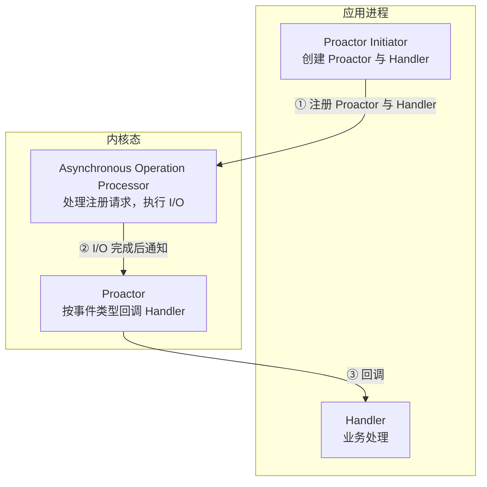

Proactor模式工作流程：
+ Proactor Initiator 负责创建 Proactor 和 Handler 对象，并将 Proactor 和 Handler 都通过Asynchronous Operation Processor 注册到内核
+ Asynchronous Operation Processor 负责处理注册请求，并处理 I/O 操作
+ Asynchronous Operation Processor 完成 I/O 操作后通知 Proactor
+ Proactor 根据不同的事件类型回调不同的 Handler 进行业务处理
+ Handler 完成业务处理


「Linux 的异步 I/O 不完善、只有 Windows 的 IOCP 才算真正支持 socket 异步」这一度是共识，但现在需要打个补丁：

+ **Linux 侧已经不再是「只有用户空间模拟的异步」**。内核从 5.1（2019 年）起引入 **io_uring**：它用一对共享内存的环形队列（提交队列 SQ + 完成队列 CQ）代替频繁的系统调用，把异步读写真正做进了内核，并且从 5.5 起支持网络 socket 上的异步收发。所以在 Linux 上同样可以写 Proactor 风格的高性能网络程序，io_uring 也已经是当下主流的异步 I/O 方案（Nginx、Redis 等都在逐步接入）。
+ **老接口的定位可以这样理解**：POSIX 定义的 aio 系列函数（`aio_read` / `aio_write`）在 Linux 上由用户空间线程模拟实现、且只支持本地文件，网络 socket 不支持——这也是 io_uring 之前 Linux 高性能网络程序清一色使用 Reactor 方案的原因。
+ **Windows 侧的结论不变**：IOCP（Input/Output Completion Port）是由操作系统真正实现的异步 I/O，支持 socket，因此在 Windows 上可以直接用效率更高的 Proactor 方案。

## 一致性哈希

### 如何分配请求

大型网站绝对不止一台服务器提供服务，这个场景就是负载均衡问题。

最简单的方式就是引入一个负载均衡中间层，负责分配请求。
考虑到每个节点的硬件配置有所区别，可以引入权重，按权重值分配任务。
但这要求每个节点都有相同的存储数据。

在分布式场景下，数据被分配到了不同的节点。

### 哈希算法的弊端

哈希算法的一个致命问题是如果节点数量发生了变化，那么必须迁移改变了的映射关系。
最坏情况下，所有数据都要迁移。

### 一致性哈希算法

通过将取模的基数固定为 \\(2^{32}\\)、哈希算法固定，来进行运算。
这样将存储节点和数据映射到一个首尾相连的哈希环上。

假如要存储一个数据，那么进行hash映射后，往顺时针方向寻找存储节点。
如果增加一个节点，新增节点的下一个节点需要做数据迁移。
如果删除一个节点，那么被删除节点的数据需要迁移到下一个节点。

问题在于，一致性哈希算法不能保证存储节点在环上分布均匀，使得难以做到负载均衡。

### 虚拟节点提高均衡度

一致性算法在节点足够多的时候，均衡性会相对较好一点。

那么将每个真实节点映射为多个虚拟节点，那么即可缓解均衡性问题。
且还能带来更好的稳定性。
当一个真实节点被删除后，其虚拟节点被删除时，数据会被迁移到多个真实节点，缓解迁移的压力。

虚拟节点+一致性哈希算法非常适合硬件配置不同的场景，且还适合节点规模会发生变化的场景。

在Nginx中，权重为1的真实节点对应160个虚拟节点。

