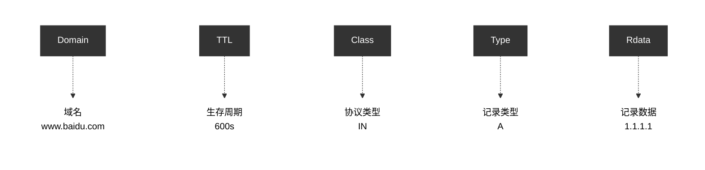

# 网络层

## IP 基本认识

## IP 地址的基础只是

## IP 协议相关技术

### DNS

我们在上网的时候，通常使用的方式是域名，而不是 IP 地址，因为域名方便人类记忆。

DNS 中的域名都是用句点来分隔的，比如 www.server.com，这里的句点代表了不同层次之间的界限。

在域名中，越**靠右**的位置表示其层级越高。
域名是一个树状结构：
+ 根 DNS 服务器
+ 顶级域 DNS 服务器（com）
+ 权威 DNS 服务器（server.com）

#AI，绘制一个图，一边是server.com，另一边是google.cn

根域的 DNS 服务器信息保存在互联网中所有的 DNS 服务器中。这样一来，任何 DNS 服务器就都可以找到并访问根域 DNS 服务器了。

客户端只要能够找到任意一台 DNS 服务器，就可以通过它找到根域 DNS 服务器，然后再一路顺藤摸瓜找到位于下层的某台目标 DNS 服务器。

假如用户使用浏览器访问。
浏览器首先看一下自己的缓存里有没有，如果没有就向操作系统的缓存要，还没有就检查本机域名解析文件 hosts，如果还是没有，就会 DNS 服务器进行查询，查询的过程如下：
+ 客户端首先会发出一个 DNS 请求，问 www.server.com 的 IP 是啥，并发给本地 DNS 服务器（也就是客户端的 TCP/IP 设置中填写的 DNS 服务器地址）。
+ 本地域名服务器收到客户端的请求后，如果缓存里的表格能找到 www.server.com，则它直接返回 IP 地址。
    + 如果没有，本地 DNS 会去问它的根域名服务器：“老大， 能告诉我 www.server.com 的 IP 地址吗？” 根域名服务器是最高层次的，它不直接用于域名解析，但能指明一条道路。
+ 根 DNS 收到来自本地 DNS 的请求后，发现后置是 .com，说：“www.server.com 这个域名归 .com 区域管理”，我给你 .com 顶级域名服务器地址给你，你去问问它吧。”
+ 本地 DNS 收到顶级域名服务器的地址后，发起请求问“老二， 你能告诉我 www.server.com  的 IP 地址吗？”
+ 顶级域名服务器说：“我给你负责 www.server.com 区域的权威 DNS 服务器的地址，你去问它应该能问到”。
+ 本地 DNS 于是转向问权威 DNS 服务器：“老三，www.server.com对应的IP是啥呀？”
+ server.com 的权威 DNS 服务器，它是域名解析结果的原出处。为啥叫权威呢？就是我的域名我做主。（权威域名一般分为自建和托管）
+ 权威 DNS 服务器查询后将对应的 IP 地址 X.X.X.X 告诉本地 DNS。
+ 本地 DNS 再将 IP 地址返回客户端，客户端和目标建立连接。

#AI，绘制一个图表示此流程

DNS缓存结构大致如下图：

当查询域名 www.baidu.com 时，域名解析记录会包含如下数据。

+ 生存周期（TTL）：表示这条记录在本地域名服务器中被缓存的时长。
+ 协议类型（Class）：一般标识为 IN，表示因特网。
+ 记录类型（Type）：A 表示 IPv4 地址，AAAA 表示 IPv6 地址。
+ 记录数据（Rdata）：与域名关联的地址信息。

DNS服务特点：只指路不带路
## `ping`工作原理

## 127.0.0.1与`ping`